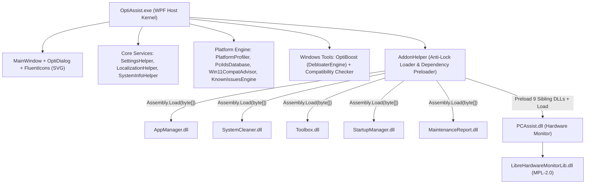
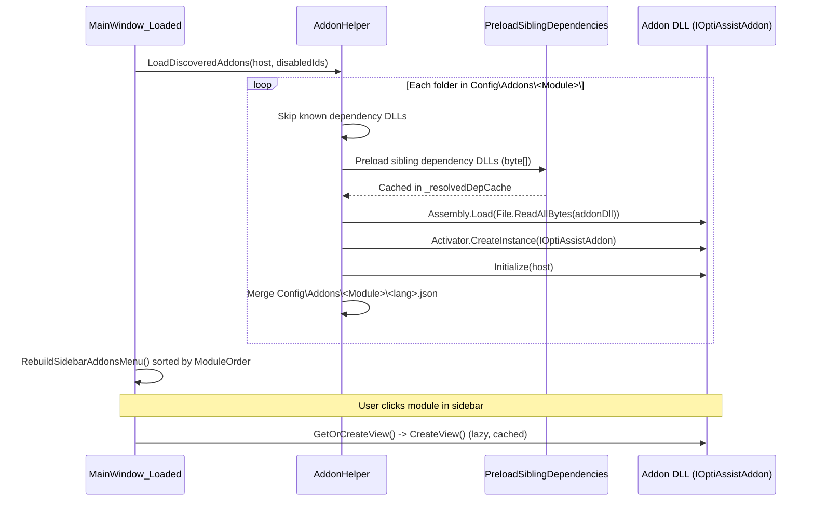

# System Architecture — OptiAssist (`v1.2.S7`)

OptiAssist is a **WPF (.NET Framework 4.8) Microkernel Host** that coordinates hardware telemetry, Windows diagnostics, and a decoupled plugin ecosystem of dynamically loaded Add-on DLLs.

---

## 1. Modular Architecture Overview

### Core Architectural Principles
1. **Zero File-Lock Assembly Loading:** Both Add-on DLLs and their co-located dependency DLLs are read into memory via `File.ReadAllBytes(...)` and loaded with `Assembly.Load(byte[])`. Files on disk are never locked, enabling runtime hot-replacement or removal.
2. **Contract Decoupling:** Add-ons reference `OptiAssist.exe` with `<Private>False</Private>` and communicate solely through `IOptiAssistAddon` and `IOptiAssistHost`.
3. **Lazy UI Initialization:** Add-on views (`CreateView()`) are constructed only when the user clicks the corresponding sidebar button, then cached in `AddonEntry.CachedView`.
4. **Unified Vector Iconography:** `FluentIcons.cs` and `FluentContentConverter` dynamically convert icon tokens across both core XAML and all 6 Add-on DLLs into theme-aware Microsoft Fluent UI SVG `<Path>` vectors.

---

## 2. Module Discovery & Loading Flow

---

## 3. Related Documentation
- [Architecture & Codebase Map](_analysis/00-map.md)
- [Module Documentation Index](modules/README.md)
- [How to Create a Module](create-module.md)
- [Build & Distribution Guide](build.md)
