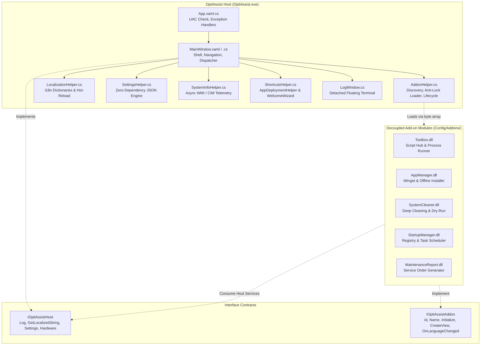
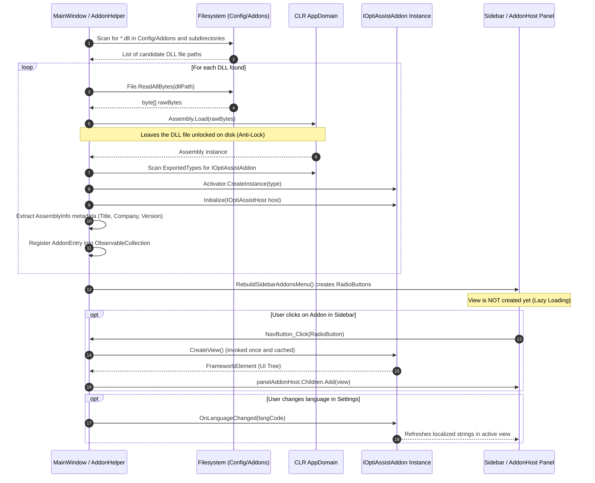

# OptiAssist Architecture and Modular System

**Document:** `docs/arch.md`  
**Platform:** Windows 10 / 11 (64-bit)  
**Framework:** .NET Framework 4.8 / WPF  
**License:** GNU General Public License v3.0  

---

## 1. Architectural Overview

OptiAssist is structured as a **Microkernel Host with Dynamic In-Memory Assembly Loading**. The central application (`OptiAssist.exe`) acts as the kernel, providing core services such as window chrome, asynchronous WMI/CIM hardware telemetry, theme and UI dispatching, thread-safe logging, and a zero-restart internationalization (i18n) engine.

Functional capabilities are divided into two distinct tiers:
1. **Host Native Views**: Integral views hardcoded into `MainWindow.xaml` (Dashboard, Windows Tools, Settings & Deployment, Logs & Terminal).
2. **Decoupled Add-on Modules**: Independent .NET Framework 4.8 Class Libraries located in `Config/Addons/<ModuleName>/<ModuleName>.dll` that implement the `IOptiAssistAddon` interface.

```
+-----------------------------------------------------------------------------------------+
|                               HOST KERNEL (OptiAssist.exe)                              |
|                                                                                         |
|  +--------------------+  +--------------------+  +-----------------+  +--------------+  |
|  | Settings & Config  |  | i18n Localization  |  | Thread-Safe Log |  | WMI Telemetry|  |
|  | (SettingsHelper)   |  | (LocalizationHelper|  | (MainWindow.Log)|  | (SystemInfo) |  |
|  +--------------------+  +--------------------+  +-----------------+  +--------------+  |
|                                                                                         |
|  +--------------------+  +--------------------+  +-----------------+  +--------------+  |
|  | Native View:       |  | Native View:       |  | Native View:    |  | Native View: |  |
|  | Dashboard          |  | Windows Tools      |  | Settings        |  | Terminal     |  |
|  +--------------------+  +--------------------+  +-----------------+  +--------------+  |
+--------------------------------------------^--------------------------------------------+
                                             |
                         Contracts: IOptiAssistAddon / IOptiAssistHost
                         In-Memory Anti-Lock Loading: Assembly.Load(byte[])
                                             |
        +------------------+-----------------+------------------+-----------------+
        |                  |                                    |                 |
        v                  v                                    v                 v
+----------------+ +----------------+                  +----------------+ +----------------+
| Toolbox (Core) | | App Manager    |                  | System Cleaner | | Startup / Rep. |
| (Toolbox.dll)  | | (AppManager.dll|                  | (Cleaner.dll)  | | (Addon DLLs)   |
+----------------+ +----------------+                  +----------------+ +----------------+
```

---

## 2. Mermaid Architecture Diagram

The diagram below illustrates the relationship between the Host Kernel, interfaces, and decoupled Add-ons:



---

## 3. Module Discovery, Anti-Lock Loading, and Lifecycle

### 3.1 Step-by-Step Loading Pipeline



### 3.2 Anti-Lock Loading Mechanism
Standard .NET assembly loading via `Assembly.LoadFrom(path)` acquires an exclusive operating system file lock on the `.dll` file, preventing updates or deletions until the host process terminates. 

OptiAssist resolves this constraint by reading the raw bytes into memory first:
```csharp
byte[] rawBytes = File.ReadAllBytes(sourceToLoad);
Assembly asm = Assembly.Load(rawBytes);
```
This enables technicians and developers to recompile, overwrite, or delete add-on modules on disk while OptiAssist is actively running.

### 3.3 Circular Dependency Resolution
Because add-on DLLs reference `OptiAssist.exe` for the `IOptiAssistAddon` and `IOptiAssistHost` interfaces, `AddonHelper` hooks into `AppDomain.CurrentDomain.AssemblyResolve`. When an add-on requests the host assembly, the handler immediately returns the running host instance:
```csharp
private static Assembly OnAssemblyResolve(object sender, ResolveEventArgs args)
{
    Assembly hostAsm = typeof(AddonHelper).Assembly;
    if (args != null && !string.IsNullOrEmpty(args.Name))
    {
        if (args.Name.StartsWith("OptiAssist,", StringComparison.OrdinalIgnoreCase) ||
            string.Equals(args.Name, hostAsm.FullName, StringComparison.OrdinalIgnoreCase))
        {
            return hostAsm;
        }
    }
    return null;
}
```

### 3.4 Lazy View Initialization
Add-on views are not created during application boot. `CreateView()` is deferred until the technician selects the module's tab in the sidebar for the first time via `entry.GetOrCreateView()`. Once created, the resulting `FrameworkElement` is cached in `AddonEntry.CachedView` for high performance during subsequent tab switches.

---

## 4. Sorting and Module Hierarchy

Discovered modules are sorted in the navigation sidebar according to `AddonHelper.GetModuleSortOrder(addon.Id)`:

| Priority Order | Module Identifier | Module Name | Core Status |
| :---: | :--- | :--- | :---: |
| **1** | `toolbox` | Toolbox | **Core Module** (`CanModify = false`, cannot be disabled or removed) |
| **2** | `app-manager` | App Manager | Optional Add-on (`CanModify = true`) |
| **3** | `system-cleaner` | System Cleaner | Optional Add-on (`CanModify = true`) |
| **4** | `startup-manager` | Startup Manager | Optional Add-on (`CanModify = true`) |
| **5** | `maintenance-report`| Maintenance Report | Optional Add-on (`CanModify = true`) |
| **50** | *custom* | External 3rd-party modules | Custom Add-on (`CanModify = true`) |
