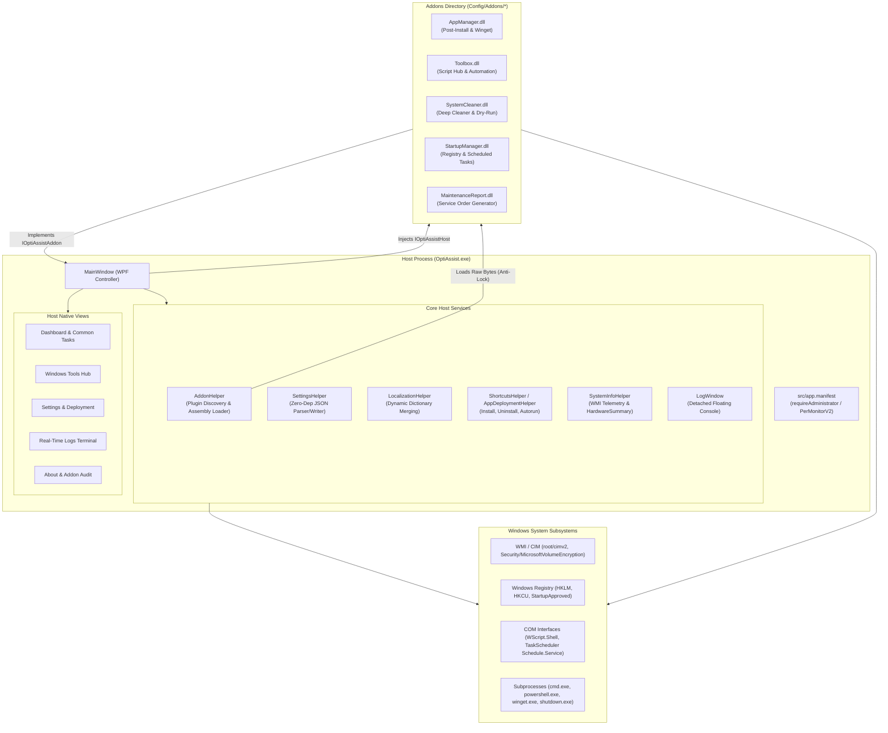
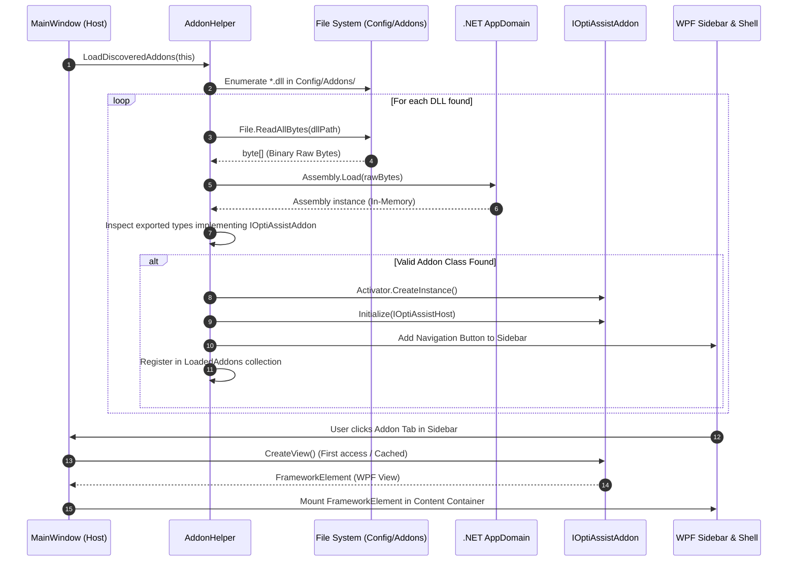

# Architecture and Technical Documentation: OptiAssist

## 1. Architectural Overview

**OptiAssist** is a native Windows desktop workbench designed for system administrators, IT support technicians, and maintenance workstations. It runs on the **.NET Framework 4.8** using **Windows Presentation Foundation (WPF)** for its user interface.

The application follows an **extensible Microkernel pattern**:
* **Host Kernel (`OptiAssist.exe`)**: Encapsulates core services such as system-wide event logging, persistent settings storage, dynamic localization (i18n), theme engine, hardware telemetry, administrative shell shortcuts, and plugin lifecycle orchestration.
* **Decoupled Add-on Modules (`Config\Addons\<Module>\<Module>.dll`)**: Independent functional modules compiled as class libraries that implement a shared interface contract (`IOptiAssistAddon`), loaded into memory dynamically at runtime.
* **Zero External Dependencies (Zero NuGets)**: The system avoids third-party packages (no `Newtonsoft.Json`, no `MahApps.Metro`, no `Costura.Fody`). All subsystems—JSON parsing/serialization, reactive UI controls, COM interop, WMI telemetry, and report compilers—are built strictly with native .NET BCL and Windows platform APIs.

---

## 2. Structural Architecture Diagram

The diagram below illustrates the relationship between the Host Kernel, its core native services, platform APIs, and dynamic Add-on modules:



---

## 3. Modular Contract: `IOptiAssistAddon` and `IOptiAssistHost`

Decoupling between the main host and add-on modules is enforced through two public interfaces defined in [`src/AddonHelper.cs`](file:///D:/Users/jvfigueiro/Desktop/OptiAssist/src/AddonHelper.cs):

### Interface `IOptiAssistAddon`
Every add-on DLL must declare a public, non-abstract class that implements this contract:

```csharp
namespace OptiAssist
{
    public interface IOptiAssistAddon
    {
        string Id { get; }
        string Name { get; }
        string Description { get; }
        string Version { get; }
        string Author { get; }
        string Icon { get; }

        void Initialize(IOptiAssistHost host);
        FrameworkElement CreateView();
        void OnLanguageChanged(string langCode);
    }
}
```

### Interface `IOptiAssistHost`
The Host kernel exposes its central operational services to modules through this contract:

```csharp
namespace OptiAssist
{
    public interface IOptiAssistHost
    {
        void Log(string message);
        string GetLocalizedString(string key, string defaultValue);
        string CurrentLanguage { get; }
        AppSettings Settings { get; }
        HardwareSummary Hardware { get; }
        void SaveSettings();
        void OpenLogWindow();
    }
}
```

---

## 4. Module Discovery and Dynamic Loading Flow

The sequence below depicts the module discovery, assembly loading without disk-locking, and view injection lifecycle:



### Key Technical Aspects of Module Loading:

1. **Anti-Lock Mechanism**:
   Using `File.ReadAllBytes` followed by `Assembly.Load(byte[])` ensures that the Windows Operating System does not place a read lock on the DLL files in `Config\Addons\`. Technicians can recompile, delete, or replace plugins on disk while OptiAssist is running.
2. **Dynamic Assembly Resolution (`AssemblyResolve`)**:
   When an external DLL references types declared in `OptiAssist.exe` (such as `IOptiAssistAddon` or `IOptiAssistHost`), the CLR AppDomain invokes the `AppDomain.CurrentDomain.AssemblyResolve` hook registered in `AddonHelper`. If the requested assembly matches `OptiAssist`, the host returns `typeof(AddonHelper).Assembly`, binding the interfaces seamlessly.
3. **Lazy UI Rendering**:
   Views are instantiated on demand through `GetOrCreateView()`. The module does not construct its WPF elements until the user first navigates to its sidebar tab, minimizing application cold-start memory footprint.
