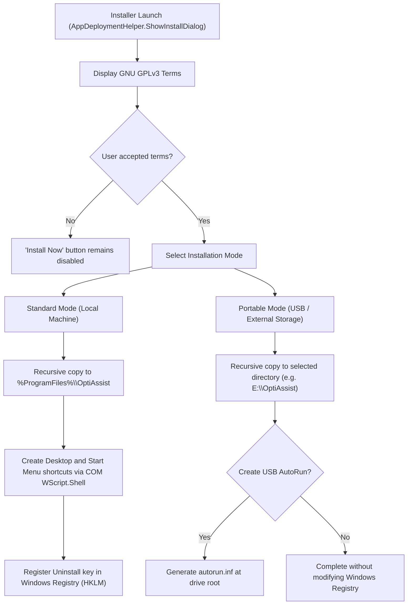

# Build, Packaging, and Distribution Guide: OptiAssist

This document provides complete instructions for building the solution from source, managing add-on dependencies, understanding the zero-dependency distribution model, and exploring the native deployment subsystem.

---

## 1. Environment Requirements

To compile OptiAssist and all modular add-ons from source, the development environment requires:

- **Operating System**: Windows 10 (1809+) or Windows 11 (64-bit recommended).
- **SDK / Runtime**: Microsoft .NET Framework 4.8 Developer Pack or SDK.
- **Compiler**: `MSBuild.exe` v4.0.30319 (located at `C:\Windows\Microsoft.NET\Framework64\v4.0.30319\`) or Visual Studio 2019/2022 MSBuild.
- **Language**: C# 7.3 or later.
- **External Dependencies**: None. The solution relies exclusively on standard .NET Framework assemblies (`mscorlib`, `System`, `System.Core`, `System.Management`, `PresentationCore`, `PresentationFramework`, `WindowsBase`, `System.Xaml`).

---

## 2. Compilation Process

### 2.1 Automated Build via `build.bat`

The root directory provides an automated batch compiler:

```cmd
build.bat
```

The script locates the 64-bit .NET 4.0/4.8 `MSBuild.exe` and compiles the primary project in `Release` mode:

```cmd
"%MSBUILD%" OptiAssist.csproj /p:Configuration=Release /v:minimal
```

### 2.2 Cascading Build Pipeline (`CleanupLocalArtifacts`)

The project file [`OptiAssist.csproj`](file:///D:/Users/jvfigueiro/Desktop/OptiAssist/OptiAssist.csproj) specifies an automated post-build target:

```xml
<Target Name="CleanupLocalArtifacts" AfterTargets="Build">
  <Delete Files="mscorlib.dll;normidna.nlp;normnfc.nlp;normnfd.nlp;normnfkc.nlp;normnfkd.nlp" />
  <MSBuild Projects="src\Addons\AppManager\AppManager.csproj" Properties="Configuration=$(Configuration);Platform=$(Platform)" />
  <MSBuild Projects="src\Addons\SystemCleaner\SystemCleaner.csproj" Properties="Configuration=$(Configuration);Platform=$(Platform)" />
  <MSBuild Projects="src\Addons\MaintenanceReport\MaintenanceReport.csproj" Properties="Configuration=$(Configuration);Platform=$(Platform)" />
  <MSBuild Projects="src\Addons\Toolbox\Toolbox.csproj" Properties="Configuration=$(Configuration);Platform=$(Platform)" />
  <MSBuild Projects="src\Addons\StartupManager\StartupManager.csproj" Properties="Configuration=$(Configuration);Platform=$(Platform)" />
</Target>
```

#### Build Execution Order:
1. **Host Executable Compilation**: MSBuild compiles `OptiAssist.exe`.
2. **NGen / GAC Artifact Cleanup**: Deletes redundant local runtime files (`mscorlib.dll`, `.nlp` localization tables).
3. **Cascading Add-on Compilation**: MSBuild invokes each add-on project in sequence. Because each add-on references the freshly built `OptiAssist.exe` with `<Private>False</Private>`, binaries output directly to `Config\Addons\<ModuleName>\<ModuleName>.dll`.

### 2.3 Partial Core Build (`CoreBuild`)
To compile only the main host without recompiling add-on plugins (avoiding file-lock conflicts if an add-on is open in a debugger):
```cmd
"C:\Windows\Microsoft.NET\Framework64\v4.0.30319\MSBuild.exe" OptiAssist.csproj /t:CoreBuild /p:Configuration=Release
```

---

## 3. Distribution Layout

Unlike applications that rely on bulky installers (Inno Setup, NSIS, MSI), OptiAssist is designed for **Autonomous Deployment**:

```text
OptiAssist/
├── OptiAssist.exe                 # Compiled host executable
├── OptiAssist.exe.config          # .NET 4.8 runtime configuration
├── Config/                        # Configuration files and plugins
│   ├── settings.json              # Main application settings
│   ├── toolbox.json               # Toolbox scripts and commands catalog
│   ├── custom_shortcuts.json      # Customizable Dashboard common tasks
│   ├── autoinstall.json           # Automated app installer definitions
│   ├── Languages/                 # Dynamic multi-language JSON dictionaries
│   │   ├── en-US.json
│   │   └── pt-BR.json
│   └── Addons/                    # Compiled decoupled add-on DLLs
│       ├── AppManager/AppManager.dll
│       ├── MaintenanceReport/MaintenanceReport.dll
│       ├── StartupManager/StartupManager.dll
│       ├── SystemCleaner/SystemCleaner.dll
│       └── Toolbox/Toolbox.dll
├── Maintenance/                   # Auxiliary portable diagnostic utilities
│   ├── CPU-Z/
│   └── CrystalDiskInfo/
└── Installers/                    # Local technician installer repository
```

---

## 4. Native Deployment Subsystem (`AppDeploymentHelper`)

OptiAssist manages its installation, portable deployment, and uninstallation directly through native C# routines in [`AppDeploymentHelper`](file:///D:/Users/jvfigueiro/Desktop/OptiAssist/src/ShortcutsHelper.cs#L342-L1307).

The graphical installer is accessible via:
1. The **Install OptiAssist** button in **Settings**.
2. Automated prompt on first launch if running from temporary storage.



### 4.1 Standard Installation Mode

When Standard Installation is selected:
1. **Target Path**: `%ProgramFiles%\OptiAssist` (`C:\Program Files\OptiAssist`).
2. **File Deployment**: `CopyDirectoryRecursive` copies all application assets (ignoring `.tmp`, `.git`, and `.vs` files).
3. **Shortcut Creation**:
   - Generates `OptiAssist.lnk` in the common Start Menu (`CommonPrograms`).
   - Generates `OptiAssist.lnk` on the common Desktop (`CommonDesktopDirectory`).
   - Uses COM reflection (`WScript.Shell`) without external library dependencies.
4. **Windows Control Panel Registration**:
   - Creates `HKLM\SOFTWARE\Microsoft\Windows\CurrentVersion\Uninstall\OptiAssist`:
     - `DisplayName`: "OptiAssist"
     - `DisplayVersion`: Assembly version
     - `Publisher`: "OptiAssist Project"
     - `InstallLocation`: `%ProgramFiles%\OptiAssist`
     - `UninstallString`: `"C:\Program Files\OptiAssist\OptiAssist.exe" /uninstall`
     - `DisplayIcon`: `"C:\Program Files\OptiAssist\OptiAssist.exe",0`

### 4.2 Portable Mode

When Portable Mode is selected:
- Allows targeting any drive letter, partition, or USB flash drive.
- Does not modify the Windows Registry.
- Does not create local user shortcuts.
- Maintains full autonomy on the removable drive.

### 4.3 USB AutoRun (`autorun.inf`)

For technician drives, OptiAssist can write an `autorun.inf` to the drive root:

```ini
[autorun]
open=OptiAssist\OptiAssist.exe
icon=OptiAssist\OptiAssist.exe,0
label=OptiAssist - Maintenance & Post-Installation
action=Start OptiAssist
shell\optiassist=Open OptiAssist
shell\optiassist\command=OptiAssist\OptiAssist.exe
shell=optiassist
```

> [!NOTE]
> Modern Windows 10 and 11 systems restrict silent executable AutoRun on USB drives for security, but the `autorun.inf` file ensures the custom icon and description are applied in Windows Explorer.

---

## 5. Uninstallation and Self-Deletion

Uninstallation can be triggered from Settings or the Windows Control Panel (`OptiAssist.exe /uninstall`).

### 5.1 CLI Argument `/uninstall`

At startup, [`App.xaml.cs`](file:///D:/Users/jvfigueiro/Desktop/OptiAssist/src/App.xaml.cs#L55-L70) detects the parameter:

```csharp
if (e.Args != null && e.Args.Length > 0)
{
    foreach (string arg in e.Args)
    {
        if (string.Equals(arg, "/uninstall", StringComparison.OrdinalIgnoreCase))
        {
            AppDeploymentHelper.UninstallOptiAssist();
            this.Shutdown();
            return;
        }
    }
}
```

### 5.2 Asynchronous Self-Deletion Mechanism

Windows prevents deleting an active running executable (`ERROR_ACCESS_DENIED`). To cleanly remove the installation directory without leaving residual files, OptiAssist uses a delayed CMD execution trick:

1. **Shortcuts & Registry Cleanup**: Removes all `.lnk` shortcuts and deletes the `HKLM` uninstall key.
2. **Delayed Process**: Spawns a background CMD process with a 3-second delay via ping before terminating:
   ```cmd
   cmd.exe /c ping 127.0.0.1 -n 3 >nul & rd /s /q "C:\Program Files\OptiAssist"
   ```
3. The main application executes `Application.Current.Shutdown()`. Once the process terminates, the background command deletes the entire installation folder.
