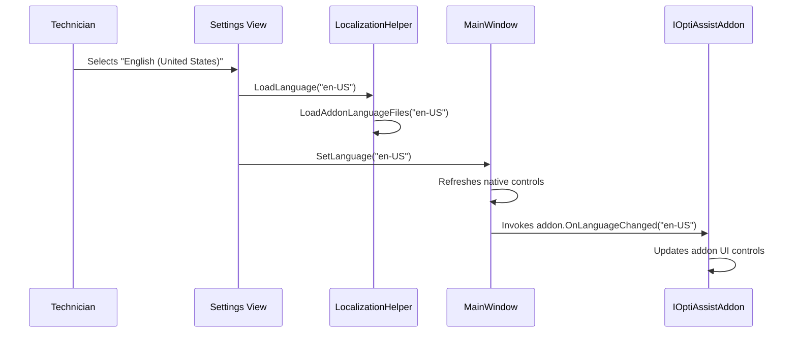

# Configuration, Localization, and Logging Guide: OptiAssist

This document details the configuration persistence subsystem, JSON storage schemas, multi-language localization engine (i18n), and real-time logging pipeline of **OptiAssist**.

---

## 1. Zero-Dependency Persistence Architecture

OptiAssist is designed to operate as a lightweight, autonomous technician tool without heavy external dependencies like `Newtonsoft.Json`. All serialization and deserialization routines use a deterministic, fault-tolerant custom JSON engine implemented in [`SettingsHelper.cs`](file:///D:/Users/jvfigueiro/Desktop/OptiAssist/src/SettingsHelper.cs).

### Data Directory Layout
All persistent state resides inside the `Config\` folder at the application root (`AppDomain.CurrentDomain.BaseDirectory`):

```text
OptiAssist/
└── Config/
    ├── settings.json              # Global application preferences
    ├── custom_shortcuts.json      # Customizable Dashboard common tasks
    ├── toolbox.json               # Toolbox scripts and command catalog
    ├── autoinstall.json           # Automated app installer definitions
    └── Languages/                 # Dynamic multi-language JSON dictionaries
        ├── en-US.json
        └── pt-BR.json
```

If the `Config\` folder or any configuration file is absent on startup, OptiAssist automatically initializes them using factory defaults.

---

## 2. Configuration Schemas

### 2.1 `settings.json` (Global Settings)

Stores operational parameters, visual styling, and disabled addons.

#### Example:
```json
{
  "CustomerName": "OptiAssist",
  "ContactInfo": "https://github.com/jvfigueiro/optiassist",
  "Language": "en-US",
  "ReportSavePath": "C:\\MaintenanceReport.txt",
  "AutoRefreshHardware": true,
  "EnableWingetFallback": true,
  "Theme": "Dark",
  "AccentColor": "#0EA5E9",
  "ServiceProviderMode": false,
  "EnableMaintenanceReport": false,
  "OpenExternalLogsByDefault": false,
  "AlwaysOnTop": false,
  "CustomLogoPath": "",
  "DisabledAddons": "MaintenanceReport"
}
```

#### Field Dictionary:

| Field | Type | Default | Description |
| :--- | :--- | :--- | :--- |
| `CustomerName` | `string` | `"OptiAssist"` | Organization or technician name in headers and reports. Legacy key: `StoreName`. |
| `ContactInfo` | `string` | Project URL | Contact telephone, website, or email in headers. Legacy key: `Phone`. |
| `Language` | `string` | `"en-US"` | Active culture language code (`"en-US"`, `"pt-BR"`). |
| `ReportSavePath` | `string` | `@"C:\MaintenanceReport.txt"` | Default destination path for exported maintenance reports. |
| `AutoRefreshHardware`| `bool` | `true` | Refreshes hardware WMI data automatically upon switching to the Dashboard. |
| `EnableWingetFallback`| `bool` | `true` | Allows App Manager to use silent Winget downloads when local installers are absent. |
| `Theme` | `string` | `"Light"` | Visual interface contrast mode (`"Light"` or `"Dark"`). |
| `AccentColor` | `string` | `"#0EA5E9"` | Hexadecimal accent color for buttons, borders, and highlights. |
| `ServiceProviderMode`| `bool` | `false` | Enables service provider branding controls in the UI. |
| `EnableMaintenanceReport`| `bool` | `false` | Shows or hides the Maintenance Report tab in the sidebar. |
| `OpenExternalLogsByDefault`| `bool` | `false` | Automatically opens the floating `LogWindow` on startup. |
| `AlwaysOnTop` | `bool` | `false` | Keeps the main application window always on top of other windows. |
| `CustomLogoPath` | `string` | `""` | Optional path to custom company logo image file. |
| `DisabledAddons` | `string` | `""` | Comma-separated list of disabled add-on IDs. |

---

### 2.2 `custom_shortcuts.json` (Dashboard Common Tasks)

Controls the quick-action shortcut cards rendered in the **Common Tasks** section of the Dashboard.

#### Example:
```json
[
  {
    "Id": "default-toolbox",
    "Title": "Toolbox",
    "Icon": "🧰",
    "TargetType": "Section",
    "TargetValue": "toolbox",
    "Arguments": ""
  },
  {
    "Id": "default-app-manager",
    "Title": "App Manager",
    "Icon": "📦",
    "TargetType": "Section",
    "TargetValue": "app-manager",
    "Arguments": ""
  },
  {
    "Id": "open-temp-folder",
    "Title": "Temp Folder",
    "Icon": "📁",
    "TargetType": "Custom",
    "TargetValue": "explorer.exe",
    "Arguments": "%TEMP%"
  }
]
```

#### Field Dictionary:
- `Id` (`string`): Unique shortcut identifier (UUID or standard key).
- `Title` (`string`): Display label on the button.
- `Icon` (`string`): Emoji or MDL2 icon glyph.
- `TargetType` (`string`): 
  - `"Section"`: Switches directly to an internal section or addon (`dashboard`, `toolbox`, `app-manager`, `system-cleaner`, `startup-manager`, `windows-tools`, `report`, `settings`, `logs`).
  - `"Custom"`: Spawns an external Windows executable or command.
- `TargetValue` (`string`): Target section key or external executable path.
- `Arguments` (`string`): Command-line parameters for `"Custom"` executions.

---

## 3. Custom JSON Parser and Serializer

The internal JSON engine operates deterministically:

1. **Fault-Tolerant Parser (`ParseSimpleJson`)**:
   - Parses lines, splits key-value pairs by `:`, and strips exterior quotes.
   - Handles escaped quotes (`\"`) and backslashes (`\\`).
   - Uses a case-insensitive dictionary (`StringComparer.OrdinalIgnoreCase`).
   - Gracefully ignores unknown or missing fields, retaining constructor defaults.
2. **Clean Serializer (`Save`)**:
   - Formats clean JSON output with 2-space indentation.
   - Automatically escapes backslashes in Windows paths (e.g. `C:\Users` becomes `C:\\Users`).

---

## 4. Multi-Language Engine (i18n)

Localization is centralized in [`LocalizationHelper`](file:///D:/Users/jvfigueiro/Desktop/OptiAssist/src/LocalizationHelper.cs).

### 4.1 Discovery and Loading
- Discovers available languages by scanning `.json` files in `Config/Languages/`.
- Loads keys into an in-memory `Dictionary<string, string>`.

### 4.2 Dynamic Add-on Language Merging (`LoadAddonLanguageFiles`)
When an add-on includes its own language dictionary in `Config/Addons/<Module>/Languages/` or `Config/Addons/<Module>/i18n/`, `LocalizationHelper` merges those keys directly into the main dictionary.

### 4.3 Zero-Restart Runtime Hot-Reloading
Switching languages immediately updates the UI without restarting:



---

## 5. Real-Time Logging Pipeline

OptiAssist provides a centralized, thread-safe logging pipeline for diagnostics and subprocess output.

### 5.1 Central Entry Point (`MainWindow.Log`)
All internal operations and add-ons report messages via:

```csharp
public void Log(string message)
```

#### Thread-Safety via WPF Dispatcher:
```csharp
if (!Dispatcher.CheckAccess())
{
    Dispatcher.Invoke(new Action(() => Log(message)));
    return;
}
```
Messages are prepended with local timestamps (`[HH:mm:ss]`), appended to `txtConsoleLog`, and scrolled into view.

### 5.2 Independent Floating Log Window (`LogWindow`)

The detached [`LogWindow`](file:///D:/Users/jvfigueiro/Desktop/OptiAssist/src/LogWindow.cs) offers:
1. **Live Synchronization**: Replicates messages immediately via `AppendLog(message)`.
2. **Clipboard Copying**: Copies the entire log buffer with one click.
3. **Buffer Clear**: Clears both the floating window and embedded console.
4. **Export to `.txt`**: Opens a native `SaveFileDialog` with UTF-8 encoding.

### 5.3 Asynchronous Subprocess Output Capture
External scripts and commands redirect standard output and standard error:

```csharp
proc.OutputDataReceived += (s, e) => { if (!string.IsNullOrEmpty(e.Data)) Log("[CMD] " + e.Data); };
proc.ErrorDataReceived += (s, e) => { if (!string.IsNullOrEmpty(e.Data)) Log("[ERROR] " + e.Data); };
proc.BeginOutputReadLine();
proc.BeginErrorReadLine();
```
This ensures long-running utilities (`sfc /scannow`, `winget install`, `dism`) display progress in real time without freezing the UI.
