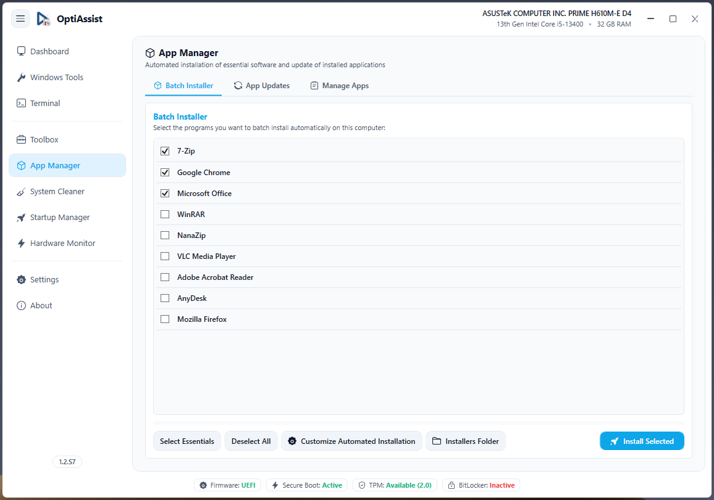
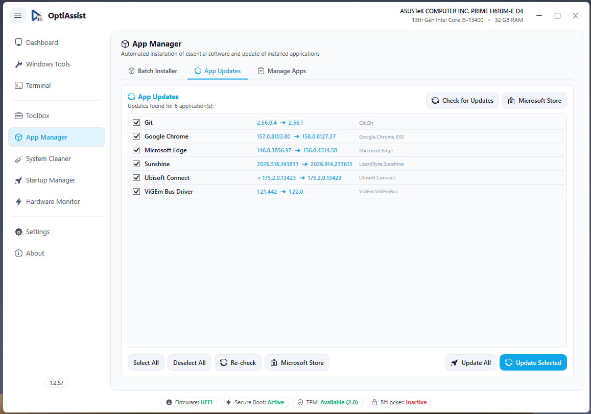

# App Manager (`app-manager`) (`v1.2.S7`)

## 1. Overview & Problem Solved
Post-installation workflows require deploying standard software suites (`7-Zip`, `Google Chrome`, `Microsoft Office`, etc.), checking for outdated packages, and auditing/uninstalling bloatware. **App Manager** consolidates offline installers, Microsoft Winget automation, and installed-app management into 3 full-height tabs.

## 2. How to Use (Step-by-Step)
1. Click **App Manager** in the sidebar.
2. **Batch Installer tab (default):** review pre-selected essentials (`7-Zip`, `Google Chrome`, `Microsoft Office` via Winget by default), check additional packages or edit the catalog, and click **Install Selected**.
3. **App Updates tab:** click **Check for Updates** / **Re-check** to scan outdated packages via Winget, select updates, or click **Microsoft Store** (`ms-windows-store:`).
4. **Manage Apps tab:** inspect installed Win32/Store apps (showing Publisher, Install Date, Install Location, Disk Size), click **Update** inline when a Winget upgrade is available, **Uninstall**, or open native **Windows Installed Apps** / **Programs and Features** (`appwiz.cpl`).

## 3. How It Works Internally
1. `InstallerHelper` loads `Config\Addons\AppManager\autoinstall.json`, checks local `Installers\` packages first, and falls back to `winget install` when `EnableWingetFallback` is enabled.
2. `AppManagerAddon` queries Registry `Uninstall` hives (`HKLM`/`HKCU`, 32/64-bit) for installed app metadata and runs `winget upgrade` / `winget list` asynchronously to match available updates.

## 4. Inputs, Outputs & Configuration
- **Inputs:** `Config\Addons\AppManager\autoinstall.json`, local `Installers\` binaries, Registry `Uninstall` keys, `winget.exe`.
- **Outputs:** Installed/updated/uninstalled software and detailed installation logs.

## 5. Requirements
- **Admin:** Required for silent system-wide installers and uninstallers.
- **Windows Version:** Windows 10 (1809+) or Windows 11.
- **External Dependencies:** `winget.exe` (Windows App Installer) and internet access for online installs/updates.

## 6. Risks & Side Effects
- Installs, upgrades, or uninstalls software silently; uninstalls are permanent unless reinstalled.

## 7. Logs & Error Handling
- Streams Winget/installer exit codes to the host log; gracefully reports missing `winget.exe` or offline failures via `OptiDialog`.

## 8. Related Source Files
- `src/Addons/AppManager/AppManagerAddon.cs`, `InstallerHelper.cs`
- `Config\Addons\AppManager\autoinstall.json`
