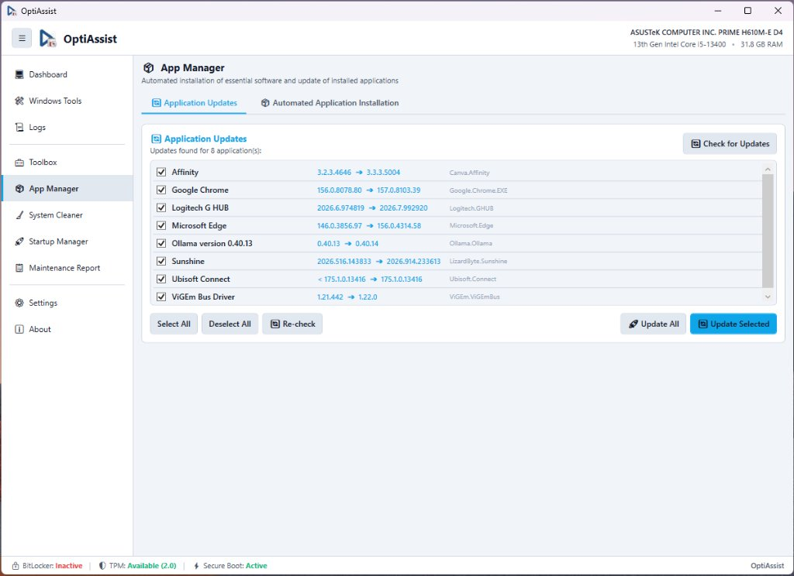

# App Manager & Software Deployment

**Module Identifier:** `app-manager`  
**Module Type:** Decoupled Add-on DLL (`Config/Addons/AppManager/AppManager.dll`)  
**Documentation Path:** `docs/modules/app-manager.md`  



---

## 1. Overview and Problem Solved

Following a clean Windows reinstallation, upgrade, or routine workstation setup, technicians must install standard software suites (web browsers, archivers, PDF readers, media players, developer tools, communication clients). Downloading and clicking through individual installation wizards manually is tedious, prone to human error, and wastes hours of technician labor.

The **App Manager** solves this problem by providing a centralized, unattended software installation and update workbench. It implements a dual-mode deployment strategy:
1. **Offline-First Local Installers**: Prioritizes local executable packages stored in the technician's `Installers/` directory, detecting installer types and running them with automated silent switches without consuming internet bandwidth.
2. **Microsoft Winget Fallback**: When an installer is not found locally, the system seamlessly falls back to the official Microsoft Windows Package Manager (`winget.exe`), downloading and installing the requested application silently.

Additionally, the App Manager incorporates an **Application Updates** scanner that queries the local system for installed packages with pending updates, allowing single-click batch upgrades.

---

## 2. Step-by-Step Usage Guide

### 2.1 Batch Unattended Software Installation
1. Open OptiAssist and navigate to **App Manager** on the sidebar.
2. Select the **Automated Application Installation** tab.
3. Review available software packages grouped into categorized checkboxes:
   - *Browsers*: Google Chrome, Mozilla Firefox, Brave, Microsoft Edge.
   - *Utilities*: 7-Zip, WinRAR, Notepad++, AnyDesk, TeamViewer.
   - *Media & Graphics*: VLC Media Player, OBS Studio, GIMP, Spotify.
   - *Productivity & Runtime*: Adobe Acrobat Reader, LibreOffice, Microsoft Visual C++ Redistributables.
4. Select packages individually or use quick preset buttons (**Select All**, **Deselect All**, **Defaults / Essentials**).
5. Click **Install Selected**:
   - The App Manager verifies whether the executable exists locally in `Installers/`.
   - If present, it executes the local installer with silent flags.
   - If absent and `EnableWingetFallback` is enabled in Settings, it invokes `winget install --id <Id> --silent`.
   - Live installation progress and console output stream directly to the terminal.

### 2.2 Updating Installed Applications
1. On the **Application Updates** tab, click **Check for Updates**.
2. OptiAssist executes an asynchronous scan via Winget to detect installed packages with newer available releases.
3. Review the populated list displaying:
   - Application Name
   - Current Version vs New Available Version
   - Package Identifier (e.g., `Google.Chrome.EXE`, `Microsoft.Edge`)
4. Check the desired applications and click **Update Selected** (or **Update All**).

### 2.3 Editing the Software Catalog
1. Click the **Edit Catalog** button to open the visual catalog manager.
2. Add new software definitions, specify custom silent switches, configure offline package filenames, or modify Winget package identifiers.

---

## 3. Internal Architecture and Technical Execution Flow

```
+------------------------------------------------------------------------------------+
|                         Technician Clicks "Install Selected"                       |
+------------------------------------------------------------------------------------+
                                           |
                                           v
                   +-----------------------------------------------+
                   | Iterates over checked items from catalog      |
                   | (autoinstall.json)                            |
                   +-----------------------------------------------+
                                           |
                                           v
                   +-----------------------------------------------+
                   | Does package file exist in Installers/ folder?|
                   +-----------------------------------------------+
                                  /                 \
                          Yes    /                   \   No
                                v                     v
      +---------------------------------+   +------------------------------------+
      | Offline Local Installer Found   |   | Is EnableWingetFallback true in    |
      +---------------------------------+   | settings.json?                     |
                      |                     +------------------------------------+
                      v                                  /            \
      +---------------------------------+        Yes    /              \   No
      | Detect Installer Type & Flags:  |              v                v
      | - Inno Setup: /VERYSILENT /NORE |   +--------------------+  +------------+
      | - NSIS: /S                      |   | Execute Winget:    |  | Log error: |
      | - InstallShield: /s /v/qn       |   | winget install     |  | Package    |
      | - MSI: msiexec /i <file> /qn    |   | --id <PackageId>   |  | unavailable|
      +---------------------------------+   | --silent           |  +------------+
                      |                     | --accept-agreements|
                      v                     +--------------------+
      +---------------------------------+              |
      | Process.Start() with redirected |              |
      | stdout/stderr to Host.Log()     |              |
      +---------------------------------+              |
                      |                                |
                      +----------------+---------------+
                                       |
                                       v
                      +---------------------------------+
                      | Verify Exit Code (0 = Success)  |
                      | Advance to next queued software |
                      +---------------------------------+
```

### Updates Inspection Engine:
1. When **Check for Updates** is clicked, `InstallerHelper.ScanUpdatesAsync()` executes:
   ```cmd
   winget.exe upgrade --include-unknown
   ```
2. The output table is parsed using regular expressions, extracting package name, ID, current version, and available version.
3. Items are loaded into an `ObservableCollection<AppUpdateItem>` and bound to the WPF `DataGrid` / `ItemsControl`.

---

## 4. Inputs, Outputs, and Configurations

* **Inputs**:
  * `Config/Addons/AppManager/autoinstall.json` (or root `Config/autoinstall.json`): Software catalog containing package IDs, display names, categories, local file patterns, silent command arguments, and Winget package tags.
  * Local installer files residing in the `Installers/` directory (e.g. `ChromeSetup.exe`, `7z-x64.msi`).
* **Outputs**:
  * Installed applications registered in the operating system.
  * Real-time deployment status logs streamed to `MainWindow.Log`.
* **Configurations in `Config/settings.json`**:
  * `"EnableWingetFallback": true`: Controls whether the engine should query Microsoft Winget if an installer is missing from the local folder.

---

## 5. Requirements

* **Administrative Privileges**: Required. Software installation modifies `%ProgramFiles%`, writes to `HKLM\SOFTWARE`, and registers Windows services.
* **Windows Version**: Windows 10 (1809+) and Windows 11 (64-bit recommended).
* **External Dependencies**: 
  * None for local offline installers.
  * Microsoft Windows Package Manager (`winget.exe`) is required for online downloads and updates scanning.

---

## 6. Risks and Side Effects

* **Software Changes**: Installs desktop applications onto the host system.
* **Network Bandwidth**: If falling back to Winget, downloading large packages (e.g. LibreOffice, browser suites) consumes internet bandwidth.
* **Reversibility**: Reversible by uninstalling packages via Windows Settings / Control Panel, or by running silent uninstallation commands.

---

## 7. Logging and Error Handling

* Non-zero process exit codes are detected and logged as warnings in the terminal (e.g., `[INSTALL ERROR] ExitCode 1603`).
* If `winget.exe` is absent on older Windows 10 LTSC installations and no local installer exists, the engine logs a clear notice advising the technician to place the offline installer into `Installers/` or install the App Installer package.

---

## 8. Related Source Files

* [`src/Addons/AppManager/AppManagerAddon.cs`](file:///D:/Users/jvfigueiro/Desktop/OptiAssist/src/Addons/AppManager/AppManagerAddon.cs): UI construction, tab navigation, and catalog bindings.
* [`src/Addons/AppManager/InstallerHelper.cs`](file:///D:/Users/jvfigueiro/Desktop/OptiAssist/src/Addons/AppManager/InstallerHelper.cs): Installer detection, switch builders, and Winget CLI runner.
* [`Config/Addons/AppManager/autoinstall.json`](file:///D:/Users/jvfigueiro/Desktop/OptiAssist/Config/Addons/AppManager/autoinstall.json): Default software catalog definitions.
