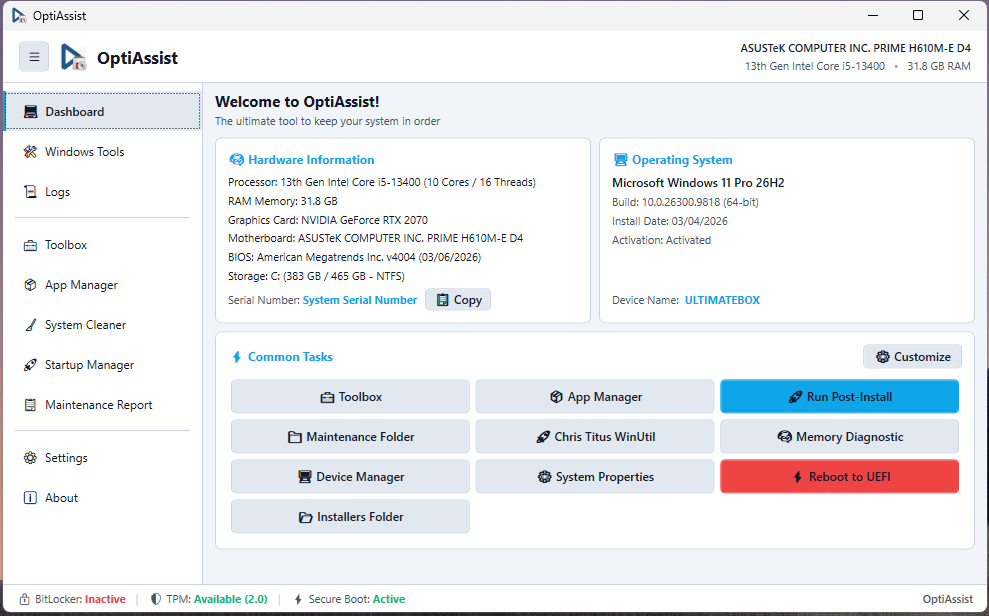

# Dashboard & Hardware Telemetry

**Module Identifier:** `dashboard`  
**Module Type:** Host Native View (`MainWindow`)  
**Documentation Path:** `docs/modules/dashboard.md`  



---

## 1. Overview and Problem Solved

When initiating a diagnostics session, maintenance procedure, or post-installation review on a customer's machine, IT technicians must quickly gather key system telemetry: CPU model, core and thread count, total and usable physical RAM, motherboard manufacturer and model, BIOS version and date, serial number / service tag, exact Windows version with update revision, installation date, activation status, and the system's security posture (BitLocker drive encryption, TPM 2.0 module availability, and Secure Boot state).

Manually gathering these metrics on Windows requires running multiple disjointed utilities (`msinfo32`, `dxdiag`, `winver`, `tpm.msc`, `diskmgmt.msc`, and PowerShell commands), wasting valuable technician bench time.

The **Dashboard** solves this problem by executing an asynchronous, non-blocking telemetry audit across native Windows subsystems (WMI, CIM, and the Windows Registry) directly upon application launch. It also provides a customizable **Common Tasks** command center where technicians can instantly launch maintenance utilities, switch UI themes, trigger full post-installation deployments, inspect technician storage directories, or trigger a direct firmware reboot to UEFI.

---

## 2. Step-by-Step Usage Guide

1. **Launch OptiAssist as Administrator**:
   - The application automatically opens to the **Dashboard** view.
2. **Review Diagnostic Cards**:
   - **Operating System Card**: Inspect the Windows edition name (e.g., `Microsoft Windows 11 Pro`), exact build with UBR revision (`10.0.26300.9818 64-bit`), original installation date, and genuine activation status (`Activated`).
   - **Hardware Information Card**: Review processor model (cores and threads), total physical RAM capacity, graphics adapter (GPU), motherboard board model, BIOS release date/version, and machine serial number.
   - **Copy Serial Number**: Click the **Copy** button alongside the Serial Number to instantly place the hardware service tag into the Windows clipboard.
   - **Security Status Indicators**: Look at the bottom status bar for BitLocker (`Active` / `Inactive`), TPM status (`Available (2.0)` / `Not Available`), and Secure Boot (`Active` / `Inactive`).
3. **Refresh Telemetry Manually**:
   - Click the **Dashboard** button on the left sidebar at any time to re-trigger an asynchronous hardware re-scan in the background.
4. **Execute Quick Actions (Common Tasks)**:
   - Click any button in the Common Tasks grid to execute predefined actions:
     - **Toolbox**: Switch directly to the repair and script hub.
     - **App Manager**: Switch directly to unattended software deployment.
     - **Run Post-Install**: Launch automated batch installation of software packages.
     - **Maintenance Folder**: Open the local `Maintenance/` portable utilities directory.
     - **Installers Folder**: Open the local `Installers/` offline repository.
     - **Chris Titus WinUtil**: Launch the Chris Titus open-source utility in the background with stdout streaming to the logs terminal.
     - **Memory Diagnostic**: Launch Windows Memory Diagnostic (`mdsched.exe`).
     - **Device Manager**: Launch native Device Manager (`devmgmt.msc`).
     - **System Properties**: Launch Classic System Properties (`sysdm.cpl`).
     - **Reboot to UEFI**: Safely reboot the system directly into UEFI firmware after confirmation.
     - **Install OptiAssist on PC**: Present if OptiAssist detects it is running from external or portable storage.
5. **Customize the Common Tasks Grid**:
   - Click the **Customize** button in the upper-right corner of the Common Tasks card.
   - Add new custom shortcuts, edit titles/icons, adjust order, or restore defaults.

---

## 3. Internal Architecture and Technical Execution Flow

```
+-----------------------------------------------------------------------------------------+
|                                    MainWindow Startup                                   |
+-----------------------------------------------------------------------------------------+
                                             |
                                             v
                      +---------------------------------------------+
                      | Is AutoRefreshHardware enabled in settings? |
                      +---------------------------------------------+
                                             |
                                             v
                      +---------------------------------------------+
                      | SystemInfoHelper.GetHardwareSummaryAsync()  |
                      | (Dispatched on background ThreadPool thread)|
                      +---------------------------------------------+
                                             |
        +------------------------------------+------------------------------------+
        |                                    |                                    |
        v                                    v                                    v
+-----------------------+          +-----------------------+          +-----------------------+
|   WMI / CIM Queries   |          |    Windows Registry   |          | Command Line Fallback |
| root\cimv2:           |          | HKLM\SOFTWARE\        |          | manage-bde.exe status |
| - Win32_OperatingSys  |          | Microsoft\Windows NT\ |          | winsat.exe (WinSPR)   |
| - Win32_Processor     |          | CurrentVersion        |          +-----------------------+
| - Win32_BaseBoard     |          | (DisplayVersion, UBR, |
| - Win32_BIOS          |          |  InstallDate)         |
| - Win32_PhysicalMemory|          | HKLM\SYSTEM\...       |
| - Win32_VideoControl  |          | Control\SecureBoot    |
| - SoftwareLicensing   |          +-----------------------+
| root\...\MicrosoftTpm |
| - Win32_Tpm           |
| root\...\Encryption   |
| - Win32_EncryptVolume |
+-----------------------+
        |                                    |                                    |
        +------------------------------------+------------------------------------+
                                             |
                                             v
                      +---------------------------------------------+
                      | HardwareSummary Model Built and Sanitized   |
                      +---------------------------------------------+
                                             |
                                             v
                      +---------------------------------------------+
                      | Dispatcher.BeginInvoke() -> Updates UI Cards|
                      +---------------------------------------------+
```

### Order of Operations:
1. `MainWindow.MainWindow_Loaded` invokes `RefreshHardwareBackground()`.
2. A background task calls `SystemInfoHelper.GetHardwareSummaryAsync()`.
3. `SystemInfoHelper` queries the following WMI classes sequentially:
   - `SELECT Caption, Version, OSArchitecture, FreePhysicalMemory, InstallDate FROM Win32_OperatingSystem`
   - `SELECT SerialNumber, Manufacturer, SMBIOSBIOSVersion, ReleaseDate FROM Win32_BIOS`
   - `SELECT Manufacturer, Product FROM Win32_BaseBoard`
   - `SELECT Name, NumberOfCores, NumberOfLogicalProcessors FROM Win32_Processor`
   - `SELECT TotalPhysicalMemory FROM Win32_ComputerSystem`
   - `SELECT Name, AdapterRAM FROM Win32_VideoController`
   - `SELECT LicenseStatus FROM SoftwareLicensingProduct WHERE ApplicationID = '55c92734-d682-4d71-983e-d6ec3f16059f' AND LicenseStatus = 1`
   - `SELECT IsActivated_InitialValue, IsEnabled_InitialValue, SpecVersion FROM Win32_Tpm` (in namespace `root\cimv2\Security\MicrosoftTpm`) with fallback to `Win32_PnPEntity WHERE PNPClass = 'SecurityDevices'`
   - `SELECT DeviceID, DriveLetter, ProtectionStatus, ConversionStatus, EncryptionMethod, VolumeType FROM Win32_EncryptableVolume` (in namespace `root\cimv2\Security\MicrosoftVolumeEncryption`) with fallback to `manage-bde.exe -status C:`
4. Registry keys are read:
   - `HKLM\SOFTWARE\Microsoft\Windows NT\CurrentVersion`: reads `DisplayVersion`, `UBR`, and fallback Unix timestamp `InstallDate`.
   - `HKLM\SYSTEM\CurrentControlSet\Control\SecureBoot\State`: reads DWORD `UEFISecureBootEnabled` (1 = Active).
5. All retrieved values are packaged into the `HardwareSummary` model and pushed to UI elements via `Dispatcher.BeginInvoke`.
6. Common tasks shortcuts are parsed from `Config/custom_shortcuts.json` via `CustomShortcutsHelper.Load()` and rendered dynamically in `UniformGrid ugCommonTasks`.

---

## 4. Inputs, Outputs, and Configurations

* **Inputs**:
  * `Config/custom_shortcuts.json`: Configured shortcuts array (`Id`, `Title`, `Icon`, `TargetType`, `TargetValue`, `Arguments`, `ButtonVariant`).
  * Live Windows WMI/CIM tables and registry hives.
* **Outputs**:
  * Real-time hardware telemetry displayed on `panelDashboard`.
  * Status badges in the main window footer (`BitLocker`, `TPM`, `Secure Boot`).
  * Machine serial number copied to Windows clipboard on user click.
* **Configurations in `Config/settings.json`**:
  * `"AutoRefreshHardware": true`: Controls whether the hardware audit executes automatically on launch and when switching back to the Dashboard tab.

---

## 5. Requirements

* **Administrative Privileges**: Required. WMI access to `SoftwareLicensingProduct`, `MicrosoftTpm`, `MicrosoftVolumeEncryption`, and `HKLM` keys fails without elevation.
* **Windows Version**: Windows 10 (version 1809+) and Windows 11 (64-bit recommended).
* **External Dependencies**: Zero. Relies strictly on `System.Management.dll`, `Microsoft.Win32`, and native Windows binaries.

---

## 6. Risks and Side Effects

* **Hardware Telemetry Queries**: 100% read-only and safe. Does not modify hardware configuration or write to the registry.
* **Common Tasks - Reboot to UEFI**: Calls `shutdown.exe /r /fw /t 0`. Prompts the user with an explicit confirmation dialog before rebooting.
* **Common Tasks - External Scripts**: Shortcuts pointing to external tools (e.g. Chris Titus WinUtil) run independently; actions executed inside external tools modify system configurations.

---

## 7. Logging and Error Handling

* All WMI queries are wrapped in individual `try-catch` blocks. If a query fails (e.g. BitLocker WMI unavailable on Windows Home edition), the system gracefully sets the status to "Not Available" or executes the command-line fallback without throwing an unhandled exception.
* Background execution of Common Tasks routes `stdout` and `stderr` directly into `MainWindow.Log(message)` for live terminal tracking.

---

## 8. Related Source Files

* [`src/MainWindow.xaml`](file:///D:/Users/jvfigueiro/Desktop/OptiAssist/src/MainWindow.xaml): Dashboard layout, telemetry cards, and Common Tasks grid.
* [`src/MainWindow.xaml.cs`](file:///D:/Users/jvfigueiro/Desktop/OptiAssist/src/MainWindow.xaml.cs): Telemetry dispatcher and shortcut execution coordinator.
* [`src/SystemInfoHelper.cs`](file:///D:/Users/jvfigueiro/Desktop/OptiAssist/src/SystemInfoHelper.cs): Core WMI/CIM engine and `HardwareSummary` data models.
* [`src/SettingsHelper.cs`](file:///D:/Users/jvfigueiro/Desktop/OptiAssist/src/SettingsHelper.cs): `CustomShortcutsHelper` parser and shortcut serializer.
