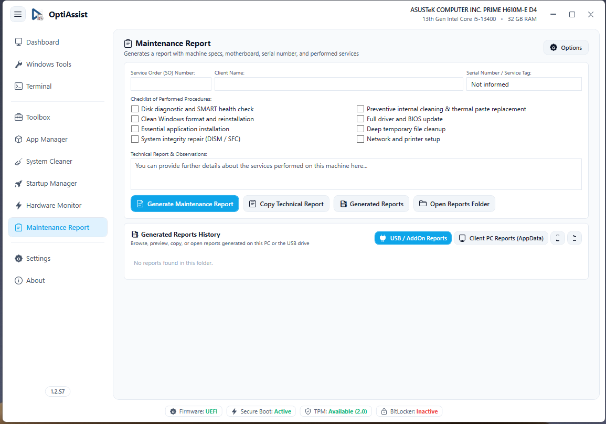

# Maintenance Report (`maintenance-report`) (`v1.2.S7`)

## 1. Overview & Problem Solved
Repair workshops and IT technicians need standardized service-order documentation summarizing customer details, detected machine specifications, performed maintenance steps, and technician notes. **Maintenance Report** generates structured `.txt` reports directly from live telemetry.

## 2. How to Use (Step-by-Step)
1. Enable **Maintenance Report** in **Settings > Installed Modules & Plugins** if disabled by default, then click **Maintenance Report** in the sidebar.
2. Enter customer/device details and check off completed maintenance procedures from the 8-point checklist.
3. Click **Export Report** to save a structured `.txt` summary (default path configured in `ReportSavePath` or chosen via `SaveFileDialog`).

## 3. How It Works Internally
1. Reads `IOptiAssistHost.Hardware` for CPU, RAM, GPU, motherboard, serial number, and OS details.
2. Formats the checklist, custom notes, and timestamps into a UTF-8 `.txt` report and writes it to disk.

## 4. Inputs, Outputs & Configuration
- **Inputs:** `IOptiAssistHost.Hardware`, user form fields, `ReportSavePath` in `Config\settings.json`.
- **Outputs:** `.txt` technical service report.

## 5. Requirements
- **Admin:** Not required for report generation.
- **Windows Version:** Windows 10 / 11.
- **External Dependencies:** None.

## 6. Risks & Side Effects
- Creates a `.txt` file at the user-selected location; non-destructive.

## 7. Logs & Error Handling
- Logs export path to `IOptiAssistHost.Log` and catches file write errors via `OptiDialog.Show(...)`.

## 8. Related Source Files
- `src/Addons/MaintenanceReport/MaintenanceReportAddon.cs`
