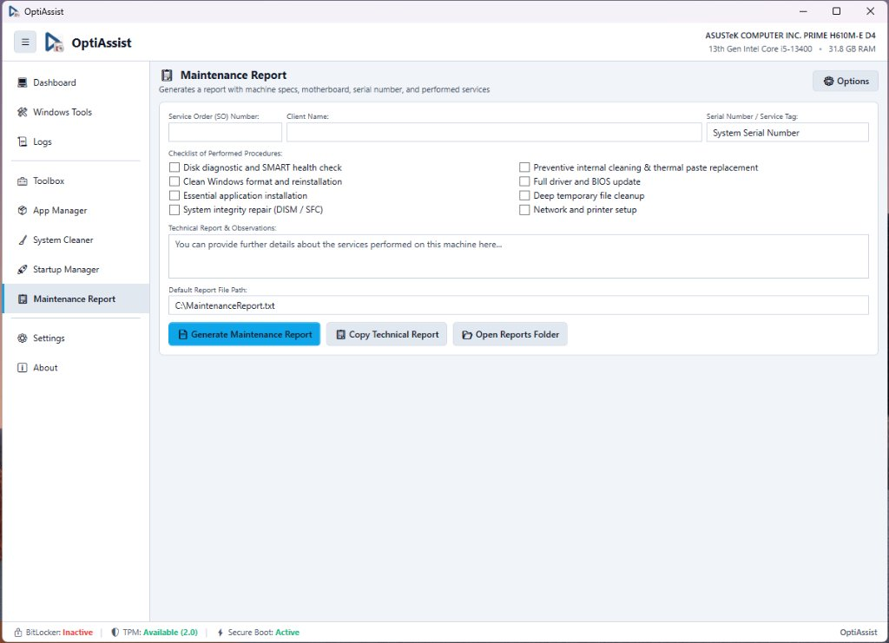

# Maintenance Report (Service Order & Technical Report)

**Module Identifier:** `MaintenanceReport`  
**Type:** Decoupled Modular Add-on (`IOptiAssistAddon`)  
**DLL Location:** `Config\Addons\MaintenanceReport\MaintenanceReport.dll`  
**Documentation File:** `docs/modules/maintenance-report.md`  



---

## 1. Overview and Problem Solved

Providing customers with a professional summary of hardware diagnostic results and maintenance procedures is critical for transparency and credibility in computer repair workshops. Without automated reporting, technicians must manually write down specs and steps taken, which is tedious and error-prone.

The **Maintenance Report** module solves this by generating standardized, formatted technical reports that consolidate:
- Client and technician identification.
- Automatically captured hardware and operating system telemetry.
- An 8-step maintenance checklist covering physical cleaning, thermal paste replacement, updates, and integrity scans.
- One-click clipboard copying (for instant WhatsApp/Email updates) and formatted `.txt` file export.

---

## 2. Step-by-Step Usage Guide

1. In the sidebar, click **📋 Report** (enable in Settings if hidden).
2. Complete the service order fields:
   - **Customer Name**: Client or business name.
   - **Contact / Phone**: Phone number or email.
   - **Technician Notes**: Additional observations.
3. Review the **Maintenance Checklist** and check performed steps:
   - *Physical internal cleaning & dust removal*
   - *Thermal paste replacement*
   - *Operating system integrity scan (SFC / DISM)*
   - *Disk health check (SMART / CHKDSK)*
   - *Temporary files & cache cleanup*
   - *Windows updates installation*
   - *Essential software installation*
   - *Hardware stress test & thermal benchmark*
4. Click **📋 Copy Report** to copy the full report to the clipboard.
5. Click **💾 Save Report** to export to `Reports\MaintenanceReport_<Customer>_<Date>.txt` (and optionally save to the custom path configured in Settings).

---

## 3. Internal Architecture and Implementation

### 3.1 Report Formatting Engine
The static method `ReportHelper.GenerateReportText(MaintenanceRecord rec)` builds the output using `StringBuilder`:

```text
======================================================================
                  TECHNICAL MAINTENANCE SERVICE REPORT
======================================================================
Date: 2026-11-05 17:30
Technician / Workshop: OptiAssist Support
Customer: John Doe (Phone: +1 555-0199)

-------------------------- HARDWARE AUDIT ----------------------------
Operating System: Windows 11 Pro 64-bit (Build 22631.3007)
Processor: AMD Ryzen 5 5600X (6 Cores, 12 Threads)
Memory: 32.0 GB Physical RAM
Motherboard: ASUS PRIME B550M-A
Graphics Card: NVIDIA GeForce RTX 3070
Serial Number: MS-7C91-001

------------------------ COMPLETED PROCEDURES ------------------------
[X] Physical internal cleaning & dust removal
[X] Thermal paste replacement
[X] System integrity scan (SFC / DISM)
[X] Temporary files & cache cleanup
[ ] Windows updates installation

--------------------------- TECHNICIAN NOTES -------------------------
System running cool, CPU max temperature 68°C under load.
======================================================================
```

---

## 4. Inputs, Outputs, and Configurations

* **Inputs**:
  * Form fields (Customer, Contact, Notes).
  * Checkbox states.
  * `_host.Hardware` telemetry object.
* **Outputs**:
  * Formatted text copied to clipboard.
  * Exported report files in `Reports/`.
* **Configurations in `Config/settings.json`**:
  * `"ReportSavePath"`: Custom destination file path (default `C:\MaintenanceReport.txt`).
  * `"EnableMaintenanceReport"`: Controls tab visibility in the sidebar.

---

## 5. Requirements and Dependencies

* **Administrator Privileges**: Inherited from the host; saving to `Reports/` requires standard file write access.
* **Supported Windows Versions**: Windows 10 and Windows 11.
* **External Dependencies**: None.

---

## 6. Risks and Reversibility

* **Safe Operation**: 100% non-destructive. Creates local text documents without modifying system settings.

---

## 7. Error Handling and Logging

* File system access exceptions during report export are caught and logged, alerting the technician via a friendly error dialog.

---

## 8. Related Source Files

* [`src/Addons/MaintenanceReport/MaintenanceReportAddon.cs`](file:///D:/Users/jvfigueiro/Desktop/OptiAssist/src/Addons/MaintenanceReport/MaintenanceReportAddon.cs): Addon implementation, UI forms, and report formatting engine.
