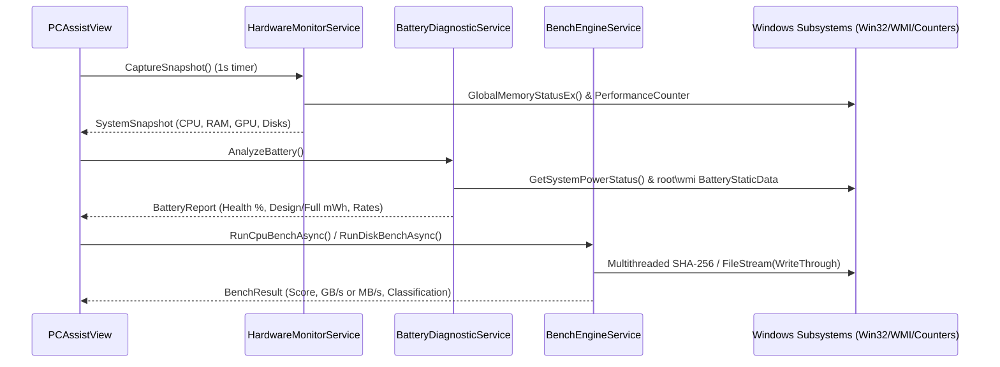

# Module: PC Assist (Hardware Monitor, Battery Health & Bench Diagnostics)

## 1. Overview and Problem Solved
During computer maintenance, repair, and hardware upgrades, technicians frequently need to:
- Monitor live hardware behavior (CPU utilization, clocks, temperatures, RAM consumption, and storage transfer rates).
- Diagnose notebook battery degradation, design vs. current maximum capacity, cell wear percentage, and estimated autonomy.
- Run quick, reproducible bench benchmarks (CPU compute throughput, RAM memory bandwidth, and sequential storage I/O) before and after procedures (such as dual-channel memory installations, SSD swaps, or thermal paste replacements).

Traditionally, technicians had to download and run multiple disparate external utilities (HWiNFO, CPU-Z, CrystalDiskMark, BatteryInfoView). **PC Assist** consolidates all of these capabilities into a single, zero-external-dependency, native WPF module seamlessly integrated into the OptiAssist microkernel.

---

## 2. Technician Usage Guide

### Step 1: Navigating the Module
Select **PC Assist** from the OptiAssist sidebar. The interface displays three dedicated sub-tabs:
1. **📊 Hardware Monitor**: Real-time 1-second telemetry of CPU, RAM, GPU, and physical storage.
2. **🔋 Battery & Power**: Mobile device battery wear, voltage, charging rates, and official Windows battery reports.
3. **🚀 Bench Diagnostics**: Quick benchmarks for CPU, RAM, disk drive, and thermal stress testing.

### Step 2: Live Hardware Monitoring
- The hardware monitor updates every second using low-overhead native counters.
- If performing intensive work, click **⏸️ Pause Monitor** in the top-right corner to freeze polling.
- Observe real-time disk transfer speeds (Read/Write MB/s) and SMART drive health warnings (`MSStorageDriver_FailurePredictStatus`).

### Step 3: Battery Health Inspection (Notebooks)
- When running on a notebook, PC Assist queries the embedded controller via ACPI WMI tables (`root\wmi`).
- Inspect the **Battery Health** percentage ($(\text{FullChargeCapacity} / \text{DesignCapacity}) \times 100$) and **Wear Level**.
- Check the estimated runtime autonomy, instantaneous voltage, and wattage discharge rate.
- Click **📄 Generate Official Report (HTML)** to automatically trigger Windows `powercfg /batteryreport` and launch the official Microsoft diagnostic in your browser.
- On desktop computers, PC Assist automatically detects the absence of battery hardware and displays a clean direct-mains AC notice.

### Step 4: Quick Benchmarks & Thermal Testing
- **CPU Multithread Benchmark**: Click **▶️ Start Benchmark** to run a 5-second multithreaded integer and cryptographic computation, generating a benchmark score with market tier comparisons.
- **RAM Bandwidth Benchmark**: Click **▶️ Start Benchmark** to allocate a sequential 128 MB buffer and measure read/write throughput in GB/s (ideal to demonstrate single-channel vs. dual-channel gains).
- **Sequential Disk Speed**: Tests sequential unbuffered read and write throughput directly on drive C: to distinguish between mechanical HDDs, SATA SSDs, and high-performance NVMe drives.
- **Thermal Stress Test (30s)**: Exercises all CPU cores at 100% compute load for 30 seconds to validate cooling system assembly, fan ramp-up, and ensure thermal throttling or shutdowns do not occur.

---

## 3. Internal Architecture & Technical Flow

### Windows APIs and Query Mechanisms
1. **Memory Load**: Win32 `kernel32.dll` `GlobalMemoryStatusEx` query for instantaneous sub-millisecond memory allocation telemetry.
2. **Processor & Disk Counters**: `PerformanceCounter("Processor", "% Processor Time", "_Total")` and `PerformanceCounter("PhysicalDisk", "Disk Read Bytes/sec", "_Total")`.
3. **ACPI Thermal Zones**: WMI `root\wmi` -> `MSAcpi_ThermalZoneTemperature` (Kelvin tenths converted to Celsius: $(K - 2732) / 10$).
4. **Notebook Battery ACPI**: WMI `root\wmi` tables:
   - `BatteryStaticData`: Designed capacity, chemistry, device name, and manufacturer.
   - `BatteryFullChargedCapacity`: Maximum attainable capacity under current cell wear.
   - `BatteryStatus`: Instantaneous voltage (mV), discharge rate (mW), and remaining capacity.
   - Win32 `GetSystemPowerStatus` for AC line status and quick desktop detection.
5. **Storage Benchmark**: Sequential file I/O using `FileOptions.WriteThrough` to bypass Windows filesystem cache and measure real physical storage media performance.

---

## 4. Requirements & Permissions
- **Administrator Privileges**: Recommended for low-level ACPI WMI queries and raw performance counters.
- **Platform**: Windows 10 and Windows 11 (64-bit and 32-bit).
- **External Dependencies**: Zero. Built purely with native .NET 4.8 and Win32/WMI APIs.

---

## 5. Related Source Files
- Implementation: [`src/Addons/PCAssist/PCAssistAddon.cs`](file:///D:/Users/jvfigueiro/Desktop/OptiAssist/src/Addons/PCAssist/PCAssistAddon.cs)
- Native Win32 Imports: [`src/Addons/PCAssist/Core/NativeMethods.cs`](file:///D:/Users/jvfigueiro/Desktop/OptiAssist/src/Addons/PCAssist/Core/NativeMethods.cs)
- Hardware Monitor Engine: [`src/Addons/PCAssist/Core/HardwareMonitorService.cs`](file:///D:/Users/jvfigueiro/Desktop/OptiAssist/src/Addons/PCAssist/Core/HardwareMonitorService.cs)
- Battery Analysis Service: [`src/Addons/PCAssist/Core/BatteryDiagnosticService.cs`](file:///D:/Users/jvfigueiro/Desktop/OptiAssist/src/Addons/PCAssist/Core/BatteryDiagnosticService.cs)
- Benchmark Engine: [`src/Addons/PCAssist/Core/BenchEngineService.cs`](file:///D:/Users/jvfigueiro/Desktop/OptiAssist/src/Addons/PCAssist/Core/BenchEngineService.cs)
- Project Configuration: [`src/Addons/PCAssist/PCAssist.csproj`](file:///D:/Users/jvfigueiro/Desktop/OptiAssist/src/Addons/PCAssist/PCAssist.csproj)
