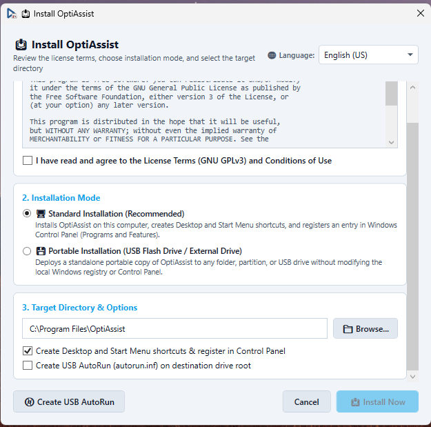

# Settings & Native Deployment

**Module Identifier:** `settings`  
**Module Type:** Host Native View (`MainWindow`)  
**Documentation Path:** `docs/modules/settings-deployment.md`  



---

## 1. Overview and Problem Solved

IT maintenance utilities often require complex configuration files, separate third-party setup packages (Inno Setup, MSI, NSIS), and rigid language systems that require application restarts. Furthermore, managing portable technician tools across diverse customer PCs requires flexible deployment: running straight from a flash drive without leaving registry residue, or performing a clean, fully registered system installation with uninstallation capabilities.

The **Settings & Deployment** module provides a centralized configuration hub and native deployment subsystem. It manages:
- **UI Personalization**: Instant theme switching (Light / Dark mode), custom hex accent colors, Always on Top window pinning, and top-bar branding logo customization.
- **Zero-Restart Internationalization (i18n)**: Dynamic language selection reading language titles and author metadata directly from translation JSON dictionaries, reloading strings in real time without restarting the application.
- **Add-on Module Management**: Enabling, disabling, installing external `.dll` modules, and removing existing add-ons (with Core protection for the Toolbox).
- **Native Deployment Engine (`AppDeploymentHelper`)**: Self-contained installation manager capable of installing OptiAssist to `%ProgramFiles%\OptiAssist`, creating Start Menu / Desktop `.lnk` shortcuts, registering clean uninstaller entries in Windows Control Panel (*Programs and Features*), and generating USB `autorun.inf` markers.
- **First-Run Welcome Wizard (`WelcomeWizardWindow`)**: Guides new users through risk disclaimers, license acceptance (GNU GPLv3), module selection, and deployment mode configuration upon first launch (`freshstart: true`).

---

## 2. Step-by-Step Usage Guide

### 2.1 Customizing Appearance and Preferences
1. Navigate to **Settings** on the sidebar.
2. **Interface Theme & Colors**:
   - Choose between **Light** and **Dark** theme via radio buttons.
   - Click the accent color preview to open the native Windows `ColorDialog` and pick a custom branding color.
3. **Language Selection**:
   - Open the **Language** ComboBox. Languages are populated dynamically (e.g. `English (US)` or `Português BR`) displaying translation author credits. Selecting an item immediately updates the entire interface.
4. **Window Behavior & Branding**:
   - Check **Always on Top** to keep OptiAssist floating over other windows during maintenance.
   - Click **Browse** next to Custom Logo to select a custom PNG image to display on the header bar (does not alter the application icon or About logo).

### 2.2 Managing Add-on Modules
1. Scroll down to the **Add-on Modules** card in Settings.
2. Toggle checkboxes to **Enable** or **Disable** individual modules (disabled modules disappear from the sidebar).
3. Click **➕ Add Module (.dll)** to import an external Class Library plugin.
4. Click **🗑️ Remove** on any custom module to delete its `.dll` and local files (Toolbox is permanently locked against deletion).

### 2.3 Installing and Deploying OptiAssist
1. Click the **Install OptiAssist** button in Settings (or use the Dashboard shortcut).
2. The **Install OptiAssist** dialog opens:
   - **Step 1: License Agreement**: Review GNU GPLv3 terms and check *I have read and agree to the License Terms*.
   - **Step 2: Installation Mode**:
     - *Standard Installation (Recommended)*: Copies files to `%ProgramFiles%\OptiAssist`, creates Start Menu and Desktop shortcuts, and registers in Windows Control Panel.
     - *Portable Installation (USB / External Drive)*: Deploys a standalone portable copy to any folder or removable partition without modifying the local Windows registry.
   - **Step 3: Target Directory & Options**: Browse for the destination folder, toggle shortcut creation, and optionally check *Create USB AutoRun (autorun.inf)*.
   - **Step 4: Module Selection**: Check which optional modules to include in the target installation (Toolbox is mandatory).
3. Click **Install Now**. The installer completes in seconds and logs the deployment.

### 2.4 Uninstalling OptiAssist
1. Click **Uninstall OptiAssist** in Settings, or run `OptiAssist.exe --uninstall` via command line or Windows *Programs and Features*.
2. A confirmation prompt appears.
3. The uninstaller removes Start Menu and Desktop shortcuts, deletes the registry key `HKLM\SOFTWARE\Microsoft\Windows\CurrentVersion\Uninstall\OptiAssist`, and removes installed files cleanly.

---

## 3. Internal Architecture and Technical Execution Flow

```
+-----------------------------------------------------------------------------------------+
|                                    Deployment Pipeline                                  |
+-----------------------------------------------------------------------------------------+
                                             |
        +------------------------------------+------------------------------------+
        |                                                                         |
        v                                                                         v
+-------------------------------+                                 +-------------------------------+
| Standard Installation Flow    |                                 | Portable USB Deployment Flow  |
| 1. Target: %ProgramFiles%\    |                                 | 1. Target: Selected Drive/Dir |
|    OptiAssist                 |                                 | 2. Copies OptiAssist.exe      |
| 2. Copies binaries & Config/  |                                 | 3. Copies Config/ & Addons/   |
| 3. Creates .lnk Shortcuts:    |                                 | 4. Filters unselected add-ons |
|    - Desktop                  |                                 | 5. If requested: writes       |
|    - Start Menu Programs      |                                 |    autorun.inf to drive root  |
|    (via COM WScript.Shell)    |                                 +-------------------------------+
| 4. Registers Uninstall Hive:  |
|    HKLM\SOFTWARE\Microsoft\  |
|    Windows\CurrentVersion\    |
|    Uninstall\OptiAssist       |
|    - DisplayName              |
|    - DisplayVersion           |
|    - UninstallString (--uninst|
+-------------------------------+
```

### First-Run Welcome Wizard Flow:
1. On application startup (`MainWindow_Loaded`), `MainWindow` checks if `_settings.FreshStart` is `"true"`. If so, it invokes `AppDeploymentHelper.ShowWelcomeWizard(this, _settings, Log)`. If the user rejects the terms, the application shuts down cleanly.
2. If `"freshstart": "true"`, `WelcomeWizardWindow` is displayed modally.
3. The wizard presents:
   - Welcome greetings and usage disclaimers.
   - Full GNU GPLv3 license terms agreement checkbox.
   - Usage mode selector: Run as is, Install to PC, or Install to USB flash drive.
   - Module selection checklist (Toolbox locked as mandatory).
4. Upon user confirmation (or declining installation), `"freshstart"` is permanently updated to `"false"` in `settings.json`, ensuring the wizard never appears again on subsequent launches.

---

## 4. Inputs, Outputs, and Configurations

* **Inputs**:
  * `Config/settings.json`: Master application preferences.
  * `Config/Languages/*.json`: Multi-language dictionary files containing translation strings, language title, and author metadata.
* **Outputs**:
  * Persisted `Config/settings.json`.
  * Files deployed to `%ProgramFiles%\OptiAssist` or removable drives.
  * Registry entries in `HKLM\SOFTWARE\Microsoft\Windows\CurrentVersion\Uninstall\OptiAssist`.
  * `.lnk` shortcuts in `%Desktop%` and `%ProgramData%\Microsoft\Windows\Start Menu\Programs`.
  * `autorun.inf` at the root of removable USB drives.

---

## 5. Requirements

* **Administrative Privileges**: Required for writing to `%ProgramFiles%` and registering the uninstall key in `HKLM`.
* **Windows Version**: Windows 10 and Windows 11 (64-bit).
* **External Dependencies**: Zero. Uses native .NET Framework BCL and COM `WScript.Shell`.

---

## 6. Risks and Side Effects

* **Standard Installation**: Modifies the Windows Registry (`Uninstall` hive) and adds shortcut links to system-wide Desktop and Start Menu directories.
* **Uninstallation**: Deletes the `%ProgramFiles%\OptiAssist` directory. If custom user files were stored inside that specific folder, they will be removed.
* **Reversibility**: **100% Reversible**. The uninstaller leaves zero residual registry keys or background services.

---

## 7. Logging and Error Handling

* File copy conflicts (e.g. attempting to install over an active, locked executable) are caught, displaying a friendly prompt advising the technician to close existing instances.
* Shortcut creation failures fall back to direct file execution without crashing the installer.
* All configuration saves and deployment events write structured records to `MainWindow.Log()`.

---

## 8. Related Source Files

* [`src/MainWindow.xaml.cs`](file:///D:/Users/jvfigueiro/Desktop/OptiAssist/src/MainWindow.xaml.cs): Settings view event coordinator, theme applicator, and language switcher.
* [`src/SettingsHelper.cs`](file:///D:/Users/jvfigueiro/Desktop/OptiAssist/src/SettingsHelper.cs): JSON parser, serializer, and `AppSettings` data model.
* [`src/LocalizationHelper.cs`](file:///D:/Users/jvfigueiro/Desktop/OptiAssist/src/LocalizationHelper.cs): i18n translation engine and dictionary loader.
* [`src/ShortcutsHelper.cs`](file:///D:/Users/jvfigueiro/Desktop/OptiAssist/src/ShortcutsHelper.cs): `AppDeploymentHelper` (installer, uninstaller, USB autorun, and `WelcomeWizardWindow`).
