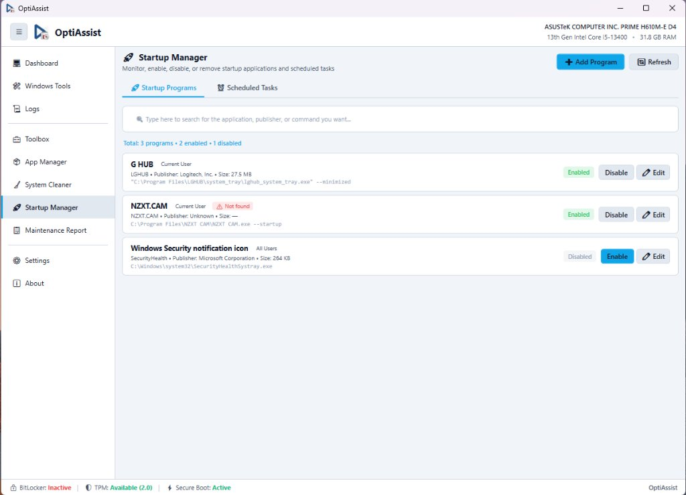

# Startup Manager & Scheduled Tasks

**Module Identifier:** `startup-manager`  
**Module Type:** Decoupled Add-on DLL (`Config/Addons/StartupManager/StartupManager.dll`)  
**Documentation Path:** `docs/modules/startup-manager.md`  



---

## 1. Overview and Problem Solved

Slow boot times and high idle RAM/CPU consumption on customer machines are frequently caused by unwanted applications that register themselves to run at system startup. Windows spreads startup configurations across multiple fragmented locations:
- 32-bit and 64-bit Registry hives (`Run` and `RunOnce`).
- The native Windows `StartupApproved` binary management hive.
- Per-user and all-users Startup folders on the filesystem.
- The Windows Task Scheduler engine (`Schedule.Service`).

Using native tools like Windows Task Manager only displays a fraction of these items, does not allow editing command arguments, and cannot manage scheduled tasks directly.

The **Startup Manager** provides a unified diagnostic inspector that aggregates autostart entries from all registry hives, filesystem startup directories, and COM-based scheduled tasks into a single, clean management interface. It enables non-destructive disabling, editing, and creation of autostart entries.

---

## 2. Step-by-Step Usage Guide

### 2.1 Managing Startup Programs
1. Navigate to **Startup Manager** on the sidebar.
2. Select the **Startup Programs** tab.
3. Review populated entries showing:
   - Application Name and Publisher
   - Scope: `Current User` or `All Users`
   - File size and executable path
   - Current Status: **Enabled** (green) or **Disabled** (grey)
   - Missing Executable Warning: Items pointing to nonexistent paths are highlighted with a red badge (`⚠️ Not found`).
4. **Enable or Disable an Application**:
   - Click **Disable** to prevent an application from launching at boot without deleting its registry entry.
   - Click **Enable** to restore automatic execution.
5. **Edit an Entry**:
   - Click **Edit** to modify the program name, target executable path, or launch arguments.
6. **Add a New Startup Item**:
   - Click **+ Add Program** in the upper toolbar, browse for an executable, assign a friendly name, and choose between Current User or All Users scope.

### 2.2 Inspecting Scheduled Tasks
1. Switch to the **Scheduled Tasks** tab.
2. By default, **Hide native Microsoft / Windows entries** is checked to protect essential operating system tasks from accidental modification.
3. If deep administrative inspection is required, uncheck the box. OptiAssist presents an explicit warning dialog to confirm that modifying native tasks may cause system instability.
4. Review the tasks list detailing:
   - Task Name and Folder Path
   - Author / Application Publisher
   - Trigger Schedule: At Startup, At User Logon, or Periodic Interval
   - State: **Ready**, **Running**, or **Disabled**
5. Click **Disable** or **Enable** on third-party updater tasks (e.g. Google Update, Adobe Update, telemetry tasks) to prevent unnecessary background wakeups.

---

## 3. Internal Architecture and Technical Execution Flow

```
+-----------------------------------------------------------------------------------------+
|                               StartupEngine.LoadAllEntries()                            |
+-----------------------------------------------------------------------------------------+
                                             |
        +------------------------------------+------------------------------------+
        |                                    |                                    |
        v                                    v                                    v
+-------------------------------+  +-------------------------------+  +-----------------------+
| Registry Run / RunOnce Scan   |  | Filesystem Startup Folders    |  | COM Schedule.Service  |
| - HKCU\...\Run & RunOnce      |  | - %APPDATA%\...\Startup       |  | - Type.GetTypeFrom    |
| - HKLM\...\Run & RunOnce      |  | - %PROGRAMDATA%\...\Startup   |  |   ProgID("Schedule.   |
| - HKLM\WOW6432Node\...\Run    |  | - Scans .lnk and .exe files   |  |   Service")           |
+-------------------------------+  +-------------------------------+  | - Connect()           |
        |                                            |                | - Recursive folder    |
        v                                            v                |   traversal           |
+-------------------------------+  +-------------------------------+  +-----------------------+
| StartupApproved Inspection    |  | Resolves COM .lnk Shortcuts   |              |
| Reads binary DWORD:           |  | via WScript.Shell to extract  |              |
| - Byte 0 == 0x02: Enabled     |  | target executable paths       |              |
| - Byte 0 == 0x03: Disabled    |  +-------------------------------+              |
+-------------------------------+                    |                            |
        |                                            |                            |
        +--------------------------------------------+----------------------------+
                                             |
                                             v
                      +---------------------------------------------+
                      | Verifies File.Exists(targetPath)            |
                      | Reads file metadata (Size, Publisher, Ver)  |
                      | Binds to ObservableCollection<StartupEntry> |
                      +---------------------------------------------+
```

### Non-Destructive Disabling Mechanism:
Rather than deleting registry keys (which would cause data loss if the technician later wanted to re-enable the item), OptiAssist interacts with Windows Explorer's official `StartupApproved` hive:
- `HKCU\Software\Microsoft\Windows\CurrentVersion\Explorer\StartupApproved\Run`
- `HKLM\Software\Microsoft\Windows\CurrentVersion\Explorer\StartupApproved\Run`

To disable an entry, the first byte of its binary value is updated to `0x03`. To enable it, the byte is restored to `0x02`. This matches the behavior of native Windows Task Manager.

---

## 4. Inputs, Outputs, and Configurations

* **Inputs**:
  * Windows Registry autostart keys (`HKCU`, `HKLM`, `WOW6432Node`).
  * Startup directory filesystem folders.
  * Windows Task Scheduler 2.0 COM service.
* **Outputs**:
  * Real-time list of startup applications and scheduled tasks.
  * Modified binary values in `StartupApproved`.
  * New or edited `.lnk` shortcuts and registry values.

---

## 5. Requirements

* **Administrative Privileges**: Required. Managing machine-wide autostart (`HKLM`, `ProgramData`, and root scheduled tasks) requires full administrative elevation.
* **Windows Version**: Windows 10 and Windows 11 (64-bit).
* **External Dependencies**: Zero. Interacts directly with Windows Registry and the built-in Windows Task Scheduler COM interface (`Schedule.Service`).

---

## 6. Risks and Side Effects

* **Disabling Vital Hardware Drivers**: Disabling startup items associated with audio control panels (Realtek), trackpads (Synaptics), or GPU helpers may disable tray utilities (hardware functions remain operational via Windows drivers).
* **Reversibility**: **100% Reversible**. Disabled items can be re-enabled instantly with a single click.

---

## 7. Logging and Error Handling

* Any COM access violations (e.g. attempting to read protected system tasks that deny access to administrator accounts) are caught and skipped gracefully without interrupting task enumeration.
* Corrupted shortcut files (`.lnk`) that fail target resolution fall back to displaying the raw shortcut path.
* All state changes (Enable, Disable, Edit, Add) write structured log entries to `MainWindow.Log()`.

---

## 8. Related Source Files

* [`src/Addons/StartupManager/StartupManagerAddon.cs`](file:///D:/Users/jvfigueiro/Desktop/OptiAssist/src/Addons/StartupManager/StartupManagerAddon.cs): UI layout, tab coordinator, and search filter.
* [`src/Addons/StartupManager/StartupEngine.cs`](file:///D:/Users/jvfigueiro/Desktop/OptiAssist/src/Addons/StartupManager/StartupEngine.cs): Registry parser, `StartupApproved` binary manipulator, and COM Task Scheduler traversal.
* [`src/Addons/StartupManager/StartupModels.cs`](file:///D:/Users/jvfigueiro/Desktop/OptiAssist/src/Addons/StartupManager/StartupModels.cs): Data models for `StartupEntry` and `ScheduledTaskEntry`.
