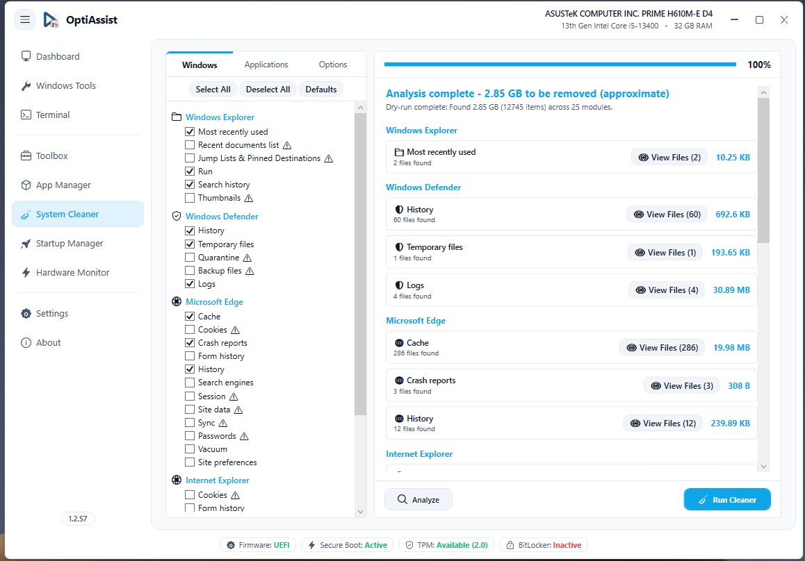

# System Cleaner (`system-cleaner`) (`v1.2.S7`)

## 1. Overview & Problem Solved
Accumulated browser caches, application logs, temporary files, and bloated SQLite databases consume gigabytes of disk space. **System Cleaner** provides a safe, non-destructive Dry-Run analyzer and CleanerML-driven cleanup engine with path safety guards and optional backup before deletion.

## 2. How to Use (Step-by-Step)
1. Click **System Cleaner** in the sidebar.
2. Select options under **Windows** or **Applications** tabs (installed apps are detected automatically).
3. Click **Analyze** to perform a non-destructive Dry-Run scan and inspect matched file paths and sizes.
4. Click **Run Cleaner**, review the confirmation dialog, choose whether to enable the **Create Backup** checkbox (`OptiDialog.ShowWithCheckbox`), and click **Continue**.

## 3. How It Works Internally
1. `CleanerMlEngine` parses 37 Windows-compatible CleanerML XML files from `Config\Addons\SystemCleaner\cleaners\*.xml` (34 BleachBit `GPL-3.0-or-later` definitions + 3 OptiAssist rules: `adobe_cache.xml`, `onedrive.xml`, `spotify.xml`).
2. `CleanerMlOptionCleaner` executes `<action>` commands (`delete`, `sqlite.vacuum`, `winreg`, `win.shell.change.notify`, `process.terminate`) using `PathSanitizer` to block protected OS/runtime directories (`\Windows\System32`, `\Windows\SysWOW64`, `\Windows\WinSxS`, VC++/WebView2).
3. `NativeCleanerHelper` P/Invokes `winsqlite3.dll` (`sqlite3_open`, `sqlite3_exec` `"VACUUM;"`, `sqlite3_close`) for browser database compaction.
4. `CleanerBackupManager` optionally archives targets before deletion.

## 4. Inputs, Outputs & Configuration
- **Inputs:** `Config\Addons\SystemCleaner\cleaners\*.xml`, `Config\Addons\SystemCleaner\settings.json`.
- **Outputs:** Scan summary (file counts, bytes to free), cleanup log, optional backup files.

## 5. Requirements
- **Admin:** Required for system-wide temporary folders, Windows Defender logs, and `HKLM` Registry entries.
- **Windows Version:** Windows 10 (1809+) or Windows 11 (`winsqlite3.dll` built into Windows 10/11).
- **External Dependencies:** BleachBit CleanerML XML definitions (`GPL-3.0-or-later`).

## 6. Risks & Side Effects
- Deletes matched temporary/cache/history files and Registry MRU keys.
- Locked files in use are skipped safely; backup checkbox allows recovery when enabled.

## 7. Logs & Error Handling
- Logs freed bytes, cleaned counts, and `locked/skipped` file counts to `CleanerContext.Log` / host log.

## 8. Related Source Files
- `src/Addons/SystemCleaner/SystemCleanerAddon.cs`
- `Config\Addons\SystemCleaner\cleaners\*.xml`, `Config\Addons\SystemCleaner\settings.json`
