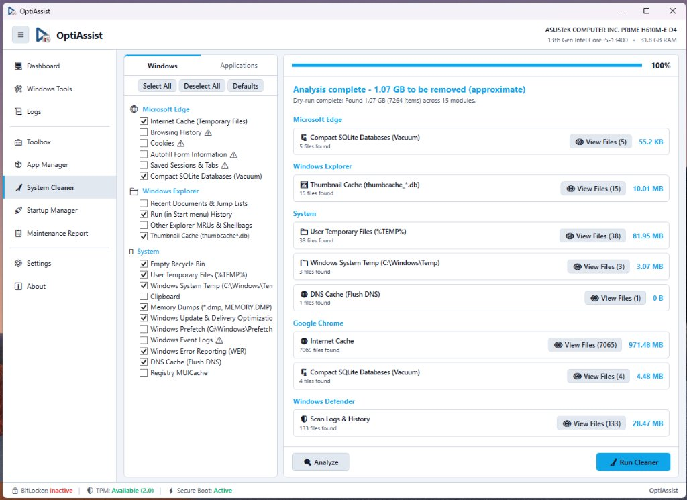

# System Cleaner & Deep Disk Cleanup

**Module Identifier:** `system-cleaner`  
**Module Type:** Decoupled Add-on DLL (`Config/Addons/SystemCleaner/SystemCleaner.dll`)  
**Documentation Path:** `docs/modules/system-cleaner.md`  



---

## 1. Overview and Problem Solved

Over months of daily use, Windows systems accumulate gigabytes of junk files: browser caches, obsolete memory dumps, error reporting buffers, Windows Update temporary caches, thumbnail databases, and orphan developer dependencies (`node_modules`, `venv`, `__pycache__`). Native tools like Windows Disk Cleanup (`cleanmgr.exe`) are slow, lack fine-grained control over third-party applications, and do not provide non-destructive preview analysis.

The **System Cleaner** provides a modular disk cleanup engine inspired by BleachBit. It organizes cleaning targets into hierarchical categories across native Windows components, web browsers, and developer environments. Technicians can execute a safe **Dry-Run Analysis** to preview recoverable storage space and examine file lists before performing permanent deletion.

---

## 2. Step-by-Step Usage Guide

1. Navigate to **System Cleaner** on the sidebar.
2. **Select Cleaning Modules**:
   - Choose between the **Windows** and **Applications** tabs:
     - **Windows Tab**:
       - *System*: Recycle Bin, User Temporary Files (`%TEMP%`), Windows System Temp (`C:\Windows\Temp`), Clipboard, Memory Dumps (`*.dmp`, `MEMORY.DMP`), Windows Update cache (`SoftwareDistribution\Download`), Windows Prefetch, Event Logs, Windows Error Reporting (WER), DNS Cache (Flush DNS).
       - *Windows Explorer*: Thumbnail Cache (`thumbcache_*.db`), Run Command History, Recent Documents.
       - *Windows Defender*: Scan Logs & History.
     - **Applications Tab**:
       - *Microsoft Edge & Google Chrome*: Internet Cache, Browsing History, Cookies, Autofill Form Information, Saved Sessions, SQLite Database Compaction (VACUUM).
       - *Developer & Deep Scan*: Node.js (`node_modules`), Python Virtual Environments (`venv`), Python bytecode (`__pycache__`).
3. **Use Presets**:
   - Click **Defaults** to load a safe, recommended technician preset.
   - Click **Select All** or **Deselect All** to adjust choices.
4. **Run Dry-Run Analysis (Scan)**:
   - Click the **Analyze** button.
   - The engine scans targeted directories, calculates recoverable bytes, and counts matched files without deleting anything.
   - Click **View Files** on any result row to view the matched file paths in a popup dialog.
5. **Execute Permanent Cleaning**:
   - Click **Run Cleaner**.
   - OptiAssist presents a confirmation prompt detailing the total gigabytes to be removed.
   - After confirmation, the cleaner purges targeted items, showing real-time progress on the percentage bar.

---

## 3. Internal Architecture and Technical Execution Flow

```
+-----------------------------------------------------------------------------------------+
|                              Technician Clicks "Analyze"                                |
+-----------------------------------------------------------------------------------------+
                                             |
                                             v
                      +---------------------------------------------+
                      | SystemCleaner.RunAnalysisAsync()            |
                      | Iterates through checked cleaning modules   |
                      +---------------------------------------------+
                                             |
        +------------------------------------+------------------------------------+
        |                                    |                                    |
        v                                    v                                    v
+-------------------------------+  +-------------------------------+  +-----------------------+
| File System Directory Scans   |  | P/Invoke Win32 API            |  | SQLite VACUUM Queries |
| - PathSanitizer.Validate()    |  | - SHQueryRecycleBin()         |  | - Opens DB connections|
| - Directory.EnumerateFiles()  |  | - Calculates Recycle Bin size |  | - Calculates overhead |
| - Aggregates FileInfo.Length  |  +-------------------------------+  +-----------------------+
+-------------------------------+                    |                            |
        |                                            |                            |
        +--------------------------------------------+----------------------------+
                                             |
                                             v
                      +---------------------------------------------+
                      | Populates AnalysisSummary Model             |
                      | Updates UI: "Analysis complete - X GB found"|
                      | Enables "Run Cleaner" Button                |
                      +---------------------------------------------+
                                             |
                                             v
+-----------------------------------------------------------------------------------------+
|                             Technician Clicks "Run Cleaner"                             |
+-----------------------------------------------------------------------------------------+
                                             |
                                             v
                      +---------------------------------------------+
                      | Deletion Execution Pipeline:                |
                      | - System files: File.Delete() / Dir.Delete()|
                      | - Locked files: catch IOException (skip)    |
                      | - Recycle Bin: SHEmptyRecycleBin()          |
                      | - Chrome/Edge: VACUUM query executed        |
                      | - DNS: ipconfig /flushdns                   |
                      +---------------------------------------------+
                                             |
                                             v
                      +---------------------------------------------+
                      | UI Progress Bar reaches 100%                |
                      | Real-time summary logged to Host.Log()      |
                      +---------------------------------------------+
```

### Safety Engine (`PathSanitizer`):
To prevent accidental damage, all delete operations pass through strict path safety checks:
- Verifies that target directories are not critical system roots (`C:\`, `C:\Windows`, `C:\Windows\System32`, `C:\Program Files`, `C:\Users`).
- Ensures target paths belong to authorized temporary, cache, or log locations.

---

## 4. Inputs, Outputs, and Configurations

* **Inputs**:
  * User checkbox selections across Windows and Application cleaning modules.
  * Local filesystem metadata and browser profile directories (`AppData\Local\Google\Chrome\User Data`, `AppData\Local\Microsoft\Edge\User Data`).
* **Outputs**:
  * Cleaned disk space reflected on system drives.
  * Real-time operation log detailing removed gigabytes and processed modules.
* **Configurations in `Config/settings.json`**:
  * System Cleaner selections can be persisted across sessions.

---

## 5. Requirements

* **Administrative Privileges**: Required. Deleting system temp files (`C:\Windows\Temp`), Prefetch, Windows Update downloads (`SoftwareDistribution`), and clearing Event Logs require full administrator permissions.
* **Windows Version**: Windows 10 and Windows 11 (64-bit).
* **External Dependencies**: Zero. Employs native .NET filesystem APIs, P/Invoke, and standard Windows command utilities.

---

## 6. Risks and Side Effects

* **Permanent Deletion**: Deleted temporary files and cache entries bypass the Windows Recycle Bin and cannot be recovered via standard undelete tools.
* **Browser Sessions**: If "Saved Sessions & Tabs" or "Cookies" are checked, active browser logins will be closed, requiring users to log back into websites.
* **Developer Artifacts**: Purging `node_modules` or `venv` requires running `npm install` or recreating virtual environments in affected programming projects.
* **Reversibility**: **Irreversible**. Always verify selections before confirming deletion.

---

## 7. Logging and Error Handling

* **Locked Files**: Files currently in use by active Windows processes (e.g., active telemetry logs or open browser locks) generate an `IOException` or `UnauthorizedAccessException`. The engine catches these errors silently, logs them to the debug stream, and continues cleaning remaining files.
* **Safety Abort**: If a module path fails `PathSanitizer` validation, execution for that target is halted immediately and an alert is recorded in `Host.Log()`.

---

## 8. Related Source Files

* [`src/Addons/SystemCleaner/SystemCleanerAddon.cs`](file:///D:/Users/jvfigueiro/Desktop/OptiAssist/src/Addons/SystemCleaner/SystemCleanerAddon.cs): Complete cleaner engine, UI layout, analysis models, safety sanitizer, and deletion runners.
