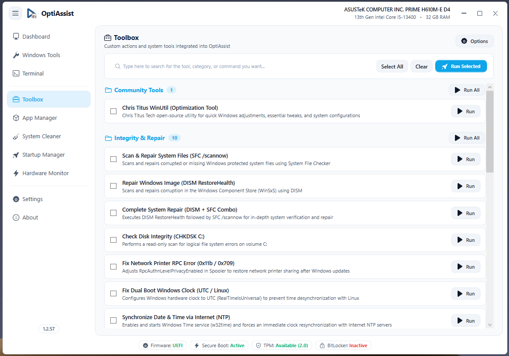

# Toolbox (`toolbox`) (`v1.2.S7`)

## 1. Overview & Problem Solved
Technicians repeatedly run repair commands (`sfc /scannow`, `DISM`, network resets, WinGet/Windows Update repairs) and custom portable scripts. **Toolbox** centralizes categorized command presets and user-defined actions with real-time streaming output and cancellation support.

## 2. How to Use (Step-by-Step)
1. Click **Toolbox** in the sidebar.
2. Browse presets by category (`Community Tools`, `Integrity & Repair`, `Networking`, etc.) or add a custom script/command.
3. Click **Run** on any item to execute it asynchronously; view live output in **Terminal** or click **Stop** to terminate a running process.

## 3. How It Works Internally
1. `ToolboxStorageManager` loads and persists actions in `Config\Addons\Toolbox\toolbox.json`.
2. `ToolboxProcessRunner` spawns `cmd.exe`, `powershell.exe` (supporting `-EncodedCommand` Base64), or direct executables with `RedirectStandardOutput` / `RedirectStandardError`, streaming lines to `IOptiAssistHost.Log` and enforcing configured `timeout_seconds`.
3. `preset-christitus-winutil` invokes `irm https://christitus.com/win | iex` externally when selected.

## 4. Inputs, Outputs & Configuration
- **Inputs:** `Config\Addons\Toolbox\toolbox.json` and portable scripts in `Config\Addons\Toolbox\Scripts\`.
- **Outputs:** Real-time stdout/stderr logs in `MainWindow.Log` / Terminal.

## 5. Requirements
- **Admin:** Required for `sfc`, `DISM`, service restarts, and `HKLM` tweaks.
- **Windows Version:** Windows 10 / 11.
- **External Dependencies:** Internet required only for remote community scripts (e.g., Chris Titus WinUtil).

## 6. Risks & Side Effects
- Executes arbitrary shell commands with Administrator privileges; review custom scripts before running.

## 7. Logs & Error Handling
- Captures exit codes, timeouts, and stderr streams; surfaces launch errors via `OptiDialog` and host logs.

## 8. Related Source Files
- `src/Addons/Toolbox/ToolboxAddon.cs`, `ToolboxModels.cs`, `ToolboxProcessRunner.cs`, `ToolboxStorageManager.cs`
- `Config\Addons\Toolbox\toolbox.json`
