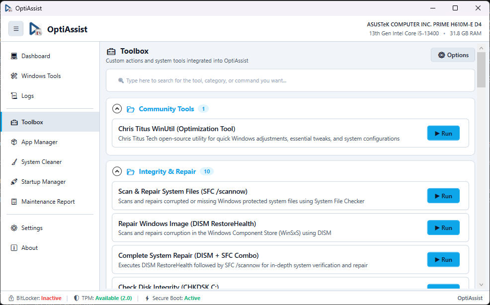

# Toolbox & Automation Hub

**Module Identifier:** `toolbox`  
**Module Type:** Decoupled Core Add-on DLL (`Config/Addons/Toolbox/Toolbox.dll`)  
**Documentation Path:** `docs/modules/toolbox.md`  



---

## 1. Overview and Problem Solved

System repair, registry tuning, network troubleshooting, and routine diagnostic tasks often require technicians to remember and execute long CLI strings (`sfc /scannow`, `dism /online /cleanup-image /restorehealth`, `ipconfig /flushdns`, `netsh winsock reset`, Windows Update service resets, and print spooler fixes). Carrying disconnected `.bat` or `.ps1` files on a USB drive is messy, lacks centralized logging, and does not provide real-time visual feedback or process cancellation.

The **Toolbox** serves as the central command runner and automation hub of OptiAssist. It organizes administrative scripts and repair presets into structured, collapsible categories with instantaneous keyword filtering, dynamic JSON persistence, Base64 command encoding for PowerShell execution, real-time stdout/stderr streaming, and process termination support.

Because of its critical role in system recovery, the Toolbox is designated as a **Core Module** (`CanModify = false`), meaning it cannot be disabled or removed by the user in Settings.

---

## 2. Step-by-Step Usage Guide

1. Navigate to **Toolbox** on the sidebar.
2. **Search for Scripts and Actions**:
   - Type keywords into the search box at the top (e.g., `sfc`, `dism`, `network`, `dns`, `printer`, `update`, `titus`). The category tree filters matching items in real time.
3. **Browse Categories**:
   - Expand or collapse categories:
     - **Community Tools**: Third-party automation (e.g. Chris Titus WinUtil).
     - **Integrity & Repair**: System File Checker (`sfc`), Component Store Repair (`DISM RestoreHealth`), Combined Repair (`DISM + SFC`), Disk Integrity (`chkdsk`).
     - **Network & Connectivity**: DNS cache flush, Winsock reset, TCP/IP stack re-initialization, network adapter reset.
     - **Maintenance & Services**: Windows Update service resets, Print Spooler cleanup, temporary file flush.
     - **System Tweaks**: Interface visual optimizations, telemetry restrictions, hardware UTC clock.
4. **Execute an Action**:
   - Click the blue **Run** button alongside the desired tool.
   - The button switches state to indicate active execution (`Running...`), and a **Cancel / Terminate** button becomes available.
   - Standard output and error streams immediately render in the terminal buffer.
5. **Cancel a Running Script**:
   - If a script or command hangs (e.g., waiting for an unreachable network endpoint), click **Cancel**. The Toolbox terminates the process tree cleanly.
6. **Customize Scripts via Options**:
   - Click the **Options** button in the upper right to add custom PowerShell, CMD, or `.reg` commands directly into the JSON catalog.

---

## 3. Internal Architecture and Technical Execution Flow

```
+-----------------------------------------------------------------------------------------+
|                              Technician Clicks "Run" on a Tool                          |
+-----------------------------------------------------------------------------------------+
                                             |
                                             v
                      +---------------------------------------------+
                      | ToolboxProcessRunner.ExecuteAsync()         |
                      | Validates command type (PowerShell/CMD/Exe) |
                      +---------------------------------------------+
                                             |
        +------------------------------------+------------------------------------+
        |                                    |                                    |
        v                                    v                                    v
+-------------------------------+  +-------------------------------+  +-----------------------+
| PowerShell Command / Script   |  | Command Prompt (CMD / Batch)  |  | Direct Binary (.exe)  |
| - Encodes command string to   |  | - Prepares cmd.exe arguments  |  | - Locates binary path |
|   UTF-16LE Base64             |  | - Sets /c switch              |  | - Sets WorkingDir     |
| - Invokes: powershell.exe     |  | - Invokes: cmd.exe /c "..."   |  | - Passes arguments    |
|   -NoProfile -ExecutionPolicy |  +-------------------------------+  +-----------------------+
|   Bypass -EncodedCommand <b64>|                    |                            |
+-------------------------------+                    |                            |
        |                                            |                            |
        +--------------------------------------------+----------------------------+
                                             |
                                             v
                      +---------------------------------------------+
                      | ProcessStartInfo configured:                |
                      | - RedirectStandardOutput = true             |
                      | - RedirectStandardError = true              |
                      | - UseShellExecute = false                   |
                      | - CreateNoWindow = true                     |
                      +---------------------------------------------+
                                             |
                                             v
                      +---------------------------------------------+
                      | Process.Start()                             |
                      | OutputDataReceived -> Host.Log() (UI Stream)|
                      | ErrorDataReceived -> Host.Log() (UI Stream) |
                      +---------------------------------------------+
                                             |
                                             v
                      +---------------------------------------------+
                      | Process.WaitForExit()                       |
                      | Button restored to "Run"                    |
                      +---------------------------------------------+
```

### Base64 Encoding Mechanism:
To avoid parsing bugs caused by nested quotes, backslashes, piping symbols (`|`), and path spaces, PowerShell commands are encoded:
```csharp
byte[] bytes = System.Text.Encoding.Unicode.GetBytes(scriptContent);
string encodedCommand = Convert.ToBase64String(bytes);
psi.FileName = "powershell.exe";
psi.Arguments = "-NoProfile -ExecutionPolicy Bypass -EncodedCommand " + encodedCommand;
```

---

## 4. Inputs, Outputs, and Configurations

* **Inputs**:
  * `Config/Addons/Toolbox/toolbox.json`: Central configuration catalog storing categories, tool names, descriptions, commands, execution types (`PowerShell`, `CMD`, `Executable`), and script file references.
  * `Config/Addons/Toolbox/Scripts/`: Directory containing bundled helper scripts:
    - `fix_printer_rpc.reg`: Fixes RPC privacy encryption mismatches on network print servers.
    - `reset_network.bat`: Flushes DNS, releases/renews DHCP, and resets Winsock.
    - `sync_internet_time.ps1`: Restarts `w32time` and resyncs system clock with `pool.ntp.org`.
    - `tweaks_interface.ps1`: Adjusts menu show delays and minimizes visual clutter.
* **Outputs**:
  * Real-time console output streamed to `IOptiAssistHost.Log`.
  * Modifications to registry keys, system services, and network stacks as defined by executed commands.
* **Configurations**:
  * JSON structure supports adding new entries with custom labels and arguments without modifying source code.

---

## 5. Requirements

* **Administrative Privileges**: Required. SFC, DISM, network resets, and registry imports require full elevation (`requireAdministrator`).
* **Windows Version**: Windows 10 and Windows 11 (64-bit).
* **External Dependencies**: Zero. Uses native `powershell.exe` (5.1+) and `cmd.exe`.

---

## 6. Risks and Side Effects

* **System Modifications**: Running tools like SFC/DISM replaces corrupted system files with known-good copies from the component store. Network resets reset IP bindings and clear routing tables.
* **Reversibility**:
  * System file repairs: Safe and self-contained.
  * Registry scripts: Reversible by applying inverse `.reg` files or through System Restore.
  * Disk check (`chkdsk /f`): May require scheduling a reboot if disk volumes are in use.

---

## 7. Logging and Error Handling

* All process events (start, output lines, error messages, and exit codes) are written synchronously to `IOptiAssistHost.Log`.
* Non-zero exit codes are highlighted with warning tags.
* Process abortion (via the **Cancel** button) calls `Process.Kill()` and handles any `Win32Exception` or `InvalidOperationException` if the process has already terminated.

---

## 8. Related Source Files

* [`src/Addons/Toolbox/ToolboxAddon.cs`](file:///D:/Users/jvfigueiro/Desktop/OptiAssist/src/Addons/Toolbox/ToolboxAddon.cs): Visual layout, search filter, and category rendering.
* [`src/Addons/Toolbox/ToolboxModels.cs`](file:///D:/Users/jvfigueiro/Desktop/OptiAssist/src/Addons/Toolbox/ToolboxModels.cs): Data models for `ToolboxCategory` and `ToolboxItem`.
* [`src/Addons/Toolbox/ToolboxProcessRunner.cs`](file:///D:/Users/jvfigueiro/Desktop/OptiAssist/src/Addons/Toolbox/ToolboxProcessRunner.cs): Process lifecycle, Base64 encoding, streaming, and cancellation engine.
* [`src/Addons/Toolbox/ToolboxStorageManager.cs`](file:///D:/Users/jvfigueiro/Desktop/OptiAssist/src/Addons/Toolbox/ToolboxStorageManager.cs): JSON catalog loader and persistence serializer.
* [`Config/Addons/Toolbox/toolbox.json`](file:///D:/Users/jvfigueiro/Desktop/OptiAssist/Config/Addons/Toolbox/toolbox.json): Script and tool definitions catalog.
