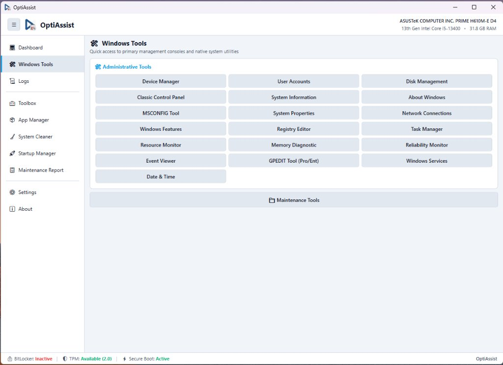

# Windows Tools & Native Consoles

**Module Identifier:** `windows-tools`  
**Module Type:** Host Native View (`MainWindow`)  
**Documentation Path:** `docs/modules/windows-tools.md`  



---

## 1. Overview and Problem Solved

Windows incorporates dozens of powerful built-in administrative consoles, configuration applets, and diagnostics utilities (`devmgmt.msc`, `diskmgmt.msc`, `services.msc`, `sysdm.cpl`, `netplwiz.exe`, `regedit.exe`, `cleanmgr.exe`, `dfrgui.exe`, `wf.msc`, `osk.exe`). However, Microsoft has fragmented these tools across the legacy Control Panel, modern Settings app, Windows Administrative Tools folder, and arbitrary system directories. Technicians often spend time searching for run commands or clicking through nested menus to reach the console they need.

The **Windows Tools** view provides a single, high-efficiency control panel that aggregates the most vital native administrative consoles, technician storage directories, and firmware boot options into organized, single-click buttons.

---

## 2. Step-by-Step Usage Guide

1. Navigate to **Windows Tools** on the sidebar.
2. **Access Administrative Tools**:
   - Click any button in the primary grid to instantly launch the desired native console:
     - **Device Manager**: `devmgmt.msc` (Hardware inspection, driver updates, error code analysis).
     - **User Accounts**: `netplwiz.exe` (User profiles, password requirements, auto-login).
     - **Disk Management**: `diskmgmt.msc` (Partitioning, volume resizing, drive letter assignments).
     - **Classic Control Panel**: `control.exe` (Legacy system configuration).
     - **System Information**: `msinfo32.exe` (Hardware abstraction and driver status).
     - **About Windows**: `winver.exe` (OS build verification).
     - **MSCONFIG Tool**: `msconfig.exe` (Boot options and safe mode selector).
     - **System Properties**: `sysdm.cpl` (Computer name, domain membership, environment variables).
     - **Network Connections**: `ncpa.cpl` (Network adapter properties, IP/DNS configuration).
     - **Windows Features**: `optionalfeatures.exe` (Enabling/disabling WSL, Hyper-V, .NET 3.5).
     - **Registry Editor**: `regedit.exe` (Windows Registry manipulation).
     - **Task Manager**: `taskmgr.exe` (Performance graphs, process monitoring).
     - **Resource Monitor**: `resmon.exe` (Real-time disk queue, memory commit, and network socket inspection).
     - **Memory Diagnostic**: `mdsched.exe` (RAM integrity test on reboot).
     - **Reliability Monitor**: `perfmon /rel` (Windows stability index and crash history).
     - **Event Viewer**: `eventvwr.msc` (System, Security, and Application error logs).
     - **GPEDIT Tool**: `gpedit.msc` (Group Policy editor on Pro and Enterprise editions).
     - **Windows Services**: `services.msc` (Background service control and startup types).
     - **Date & Time**: `timedate.cpl` (Clock settings and internet time servers).
     - **Disk Cleanup**: `cleanmgr.exe` (Native Windows drive cleaning).
     - **Defragment and Optimize Drives**: `dfrgui.exe` (SSD TRIM and HDD defragmentation).
     - **Windows Defender Firewall**: `wf.msc` (Inbound/outbound firewall rules).
     - **On-Screen Keyboard**: `osk.exe` (Virtual keyboard for tablet or broken keyboard scenarios).
3. **Access Maintenance Tools & Technician Folders**:
   - **Maintenance Folder**: Opens the local `Maintenance/` directory in Windows Explorer.
   - **Installers Folder**: Opens the local `Installers/` repository in Windows Explorer.
   - **Command Prompt (Admin)**: Launches an elevated CMD terminal.
   - **PowerShell (Admin)**: Launches an elevated Windows PowerShell console.
   - **Reboot to UEFI Firmware**: Prompts for confirmation and reboots directly into the motherboard BIOS/UEFI.

---

## 3. Internal Architecture and Technical Execution Flow

```
+-----------------------------------------------------------------------------------------+
|                              Technician Clicks a Tool Button                            |
+-----------------------------------------------------------------------------------------+
                                             |
                                             v
                      +---------------------------------------------+
                      | ShortcutsHelper.OpenWindowsTool(cmd, args)  |
                      +---------------------------------------------+
                                             |
                                             v
                      +---------------------------------------------+
                      | ProcessStartInfo setup:                     |
                      | - FileName = cmd                            |
                      | - Arguments = args                          |
                      | - UseShellExecute = true                    |
                      | - Verb = "runas" (inherits Host elevation)  |
                      +---------------------------------------------+
                                             |
                                             v
                      +---------------------------------------------+
                      | Process.Start(psi)                          |
                      | Native Windows console opens instantly      |
                      +---------------------------------------------+
```

### Direct Firmware Reboot Engine:
When the technician clicks **Reboot to UEFI**, the system executes:
```cmd
shutdown.exe /r /fw /t 0
```
- If the hardware is non-UEFI (Legacy BIOS / MBR), Windows returns error code `0x5B3` (`ERROR_NOT_SUPPORTED`).
- OptiAssist catches this exception and alerts the user that the system does not support software-triggered firmware reboot, avoiding an unexpected application crash.

---

## 4. Inputs, Outputs, and Configurations

* **Inputs**:
  * User button clicks on the tool grid.
* **Outputs**:
  * Launched native Windows `.msc`, `.cpl`, or `.exe` processes running with elevated administrator privileges.
  * Windows Explorer windows focused on local maintenance directories.

---

## 5. Requirements

* **Administrative Privileges**: Required to launch administrative consoles without secondary UAC prompts.
* **Windows Version**: Windows 10 and Windows 11.
* **Edition Notes**: `gpedit.msc` is natively available on Windows Pro, Enterprise, and Education editions; clicking it on Windows Home editions displays a notice that Group Policy is not present.

---

## 6. Risks and Side Effects

* **Console Actions**: Any changes made by the technician inside launched native consoles (e.g. deleting registry keys in `regedit`, stopping services in `services.msc`, or repartitioning in `diskmgmt.msc`) directly impact the host operating system.
* **Reboot to UEFI**: Reboots the machine immediately; unsaved user work in other applications will be lost. OptiAssist presents an explicit confirmation dialog before executing the reboot command.

---

## 7. Logging and Error Handling

* All launcher calls are wrapped in defensive `try-catch` blocks.
* If a console executable is missing or restricted by Windows AppLocker/SRP policies, an error message is recorded in `MainWindow.Log()` and an informational warning dialog is presented to the user.

---

## 8. Related Source Files

* [`src/MainWindow.xaml`](file:///D:/Users/jvfigueiro/Desktop/OptiAssist/src/MainWindow.xaml): Windows Tools grid layout and button bindings.
* [`src/MainWindow.xaml.cs`](file:///D:/Users/jvfigueiro/Desktop/OptiAssist/src/MainWindow.xaml.cs): Button click events and coordinator.
* [`src/ShortcutsHelper.cs`](file:///D:/Users/jvfigueiro/Desktop/OptiAssist/src/ShortcutsHelper.cs): `ShortcutsHelper` methods (`OpenWindowsTool`, `OpenBitLockerSettings`, `OpenGpedit`, `OpenDateTimeSettings`, etc.).
