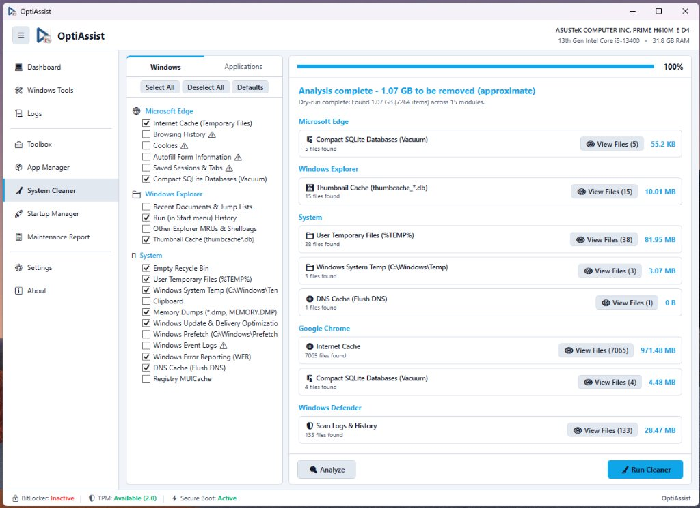

# System Cleaner (BleachBit-Style Safe Cleaning Engine)

**Module Identifier:** `SystemCleaner`  
**Type:** Decoupled Modular Add-on (`IOptiAssistAddon`)  
**DLL Location:** `Config\Addons\SystemCleaner\SystemCleaner.dll`  
**Documentation File:** `docs/modulos/system-cleaner.md`  



---

## 1. Overview and Problem Solved

Temporary files, browser caches, thumbnail databases, and log files accumulate rapidly during daily Windows usage, wasting storage and degrading disk performance. Many commercial cleaners employ aggressive, opaque cleaning routines that risk damaging system stability or corrupting user registries.

The **System Cleaner** solves this by implementing a safe, BleachBit-inspired modular cleaner architecture:
- **Non-Destructive Dry-Run (`Scan`)**: Simulates cleaning before any deletion occurs, showing exact file counts and byte sizes to be reclaimed.
- **PathSanitizer Scope Protection**: Strictly prevents scanning or deleting root drives, `%WINDIR%\System32`, or active user documents.
- **Locked-File Resilience**: Skips files in use by active processes without terminating the cleaning routine.
- **23 Specialized Cleaner Routines**: Covers Windows Core, Explorer Shell, Chromium multi-profiles (with SQLite `VACUUM;`), Windows Defender, and recursive Deep Scan for developer artifacts (`node_modules`, `venv`, `__pycache__`).

---

## 2. Step-by-Step Usage Guide

1. In the sidebar, click **🧹 System Cleaner**.
2. Select target categories:
   - **Windows Core**: `%TEMP%`, `C:\Windows\Temp`, Recycle Bin, Error Reporting, Windows Update download cache (`SoftwareDistribution\Download`).
   - **Explorer Shell**: Run MRU history, Recent Docs, Thumbnail caches, Shellbags.
   - **Chromium Browsers**: Google Chrome, Microsoft Edge, Brave, and Opera caches, GPU cache, and SQLite database compaction via `VACUUM;`.
   - **Windows Defender**: Scan and update cache cleanup.
   - **Developer & Deep Scan**: Recursive removal of `node_modules`, Python virtual environments (`.venv`, `venv`), compiled caches (`__pycache__`), Rust (`target`), and temporary `.log` files.
3. Click **🔍 Scan (Dry Run)**:
   - The scanner evaluates files, counts items, and calculates reclaimable space without modifying any data.
4. Click **🧹 Clean**:
   - Executes the safe deletion routine, streaming progress to the console.

---

## 3. Internal Architecture and Implementation

### 3.1 BaseCleaner and CleanerRegistry
Every cleaner inherits from `BaseCleaner`:

```csharp
public abstract class BaseCleaner : INotifyPropertyChanged
{
    public abstract string Id { get; }
    public abstract string Name { get; }
    public abstract string Category { get; }
    public abstract string Description { get; }

    public abstract ScanResult Scan(CleanerContext ctx);
    public abstract CleanResult Clean(CleanerContext ctx);
}
```

### 3.2 PathSanitizer Safety Guard
Before any file or directory deletion is attempted, `PathSanitizer` validates:
- Target path is not empty and has a valid drive root.
- Path is not a drive root (e.g. `C:\`).
- Path is not a protected system path (`C:\Windows`, `C:\Windows\System32`, `C:\Program Files`).
- Path is strictly located within designated temporary or cache boundaries.

### 3.3 Chromium SQLite Compaction
For web browsers, `ChromiumSqliteVacuumCleaner` executes SQLite `VACUUM;` commands on history and cookie databases, defragmenting files and reclaiming space without deleting saved user data.

---

## 4. Inputs, Outputs, and Configurations

* **Inputs**: Selected cleaner categories and checkboxes.
* **Outputs**: Deleted temporary files, compacted SQLite databases, and reclaimed disk space metrics.
* **Configurations in `Config/settings.json`**:
  * Category selections and warning preferences.

---

## 5. Requirements and Dependencies

* **Administrator Privileges**: Required to clean system temporary files (`C:\Windows\Temp`, Windows Update cache, Defender logs).
* **Supported Windows Versions**: Windows 10 and Windows 11.
* **External Dependencies**: None.

---

## 6. Risks and Reversibility

* **Safe Deletions**: Deletes transient temporary data and caches; cannot be undone, but will not damage operating system integrity.
* **Developer Artifacts**: Deleting `node_modules` or `.venv` requires re-running package managers (`npm install`, `pip install`).

---

## 7. Error Handling and Logging

* In-use locked files are caught and counted as skipped items in the final summary.
* Access violations do not interrupt remaining cleaning routines.

---

## 8. Related Source Files

* [`src/Addons/SystemCleaner/SystemCleanerAddon.cs`](file:///D:/Users/jvfigueiro/Desktop/OptiAssist/src/Addons/SystemCleaner/SystemCleanerAddon.cs): Complete cleaner engine, `BaseCleaner`, `PathSanitizer`, and UI controls.
