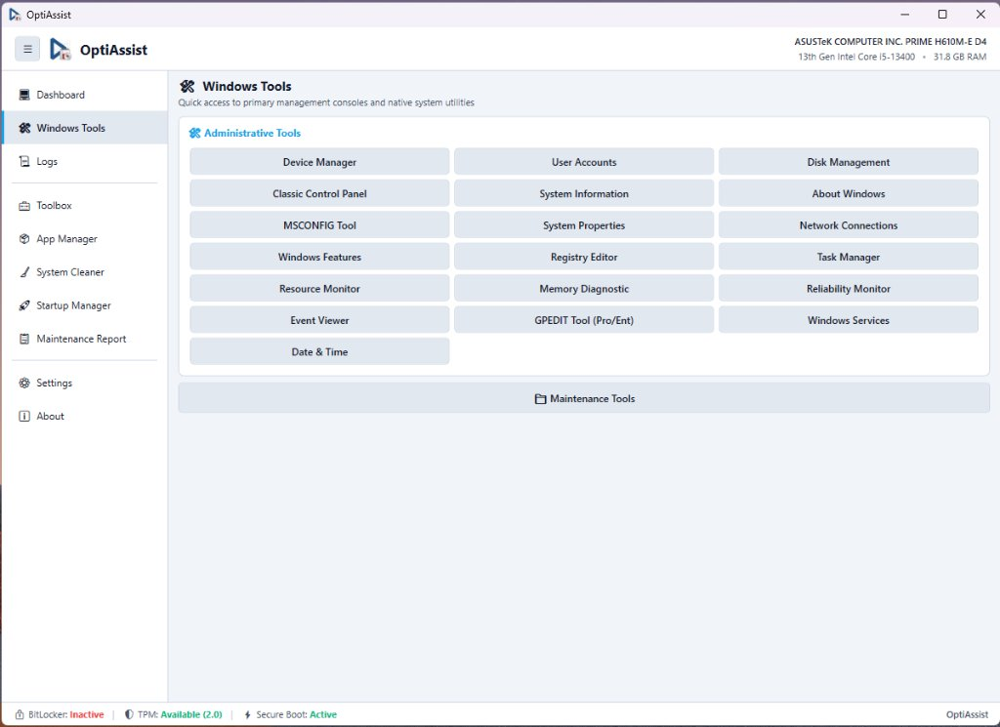

# Windows Administrative Tools (Windows Tools)

**Module Identifier:** `windows-tools`  
**Type:** Host Native View (`MainWindow`)  
**Documentation File:** `docs/modulos/windows-tools.md`  

---

## 1. Overview and Problem Solved

System administration, hardware debugging, and OS diagnostics often require opening built-in Windows consoles (`services.msc`, `compmgmt.msc`, `regedit`, `devmgmt.msc`, `cleanmgr`). Navigating through the Windows Control Panel, Start Menu, or searching Windows Settings often takes unnecessary clicks and time, especially on newly formatted systems.

The **Windows Tools** view solves this by providing a unified, fast-launch control panel:
- Over 20 native Microsoft Management Consoles (`.msc`), Control Panel applets (`.cpl`), and system executables organized cleanly.
- Automatic handling of 64-bit redirection (`sysnative`) to ensure utilities launch properly on 64-bit Windows.
- Quick-launch buttons for technician folders (`Maintenance/` and `Installers/`).
- Direct reboot to UEFI firmware (`shutdown /r /fw /t 0`).

---

## 2. Step-by-Step Usage Guide

1. In the sidebar, click **🛠️ Windows Tools**.
2. Click any tool button to launch the corresponding console immediately:
   - **Administrative Tools**: Device Manager (`devmgmt.msc`), Disk Management (`diskmgmt.msc`), Windows Services (`services.msc`), Task Manager (`taskmgr.exe`), Classic Control Panel (`control.exe`), System Information (`msinfo32.exe`), System Properties (`sysdm.cpl`), Registry Editor (`regedit.exe`), Event Viewer (`eventvwr.msc`), Resource Monitor (`resmon.exe`), Disk Cleanup (`cleanmgr.exe`), Drive Optimizer (`dfrgui.exe`), Windows Firewall (`wf.msc`), Network Connections (`ncpa.cpl`).
   - **Security Tools**: BitLocker Drive Encryption, TPM Management Console (`tpm.msc`), Local Security Policy (`secpol.msc`).
   - **Folders and Prompts**: Maintenance Tools folder (`Maintenance/`), Installers folder (`Installers/`), Command Prompt (Admin), PowerShell (Admin).
   - **Firmware**: Reboot to UEFI Firmware.

---

## 3. Internal Architecture and Implementation

### 3.1 64-Bit File System Redirection (`sysnative`)
When a 32-bit process attempts to launch tools in `System32`, Windows redirects calls to `SysWOW64`. OptiAssist is compiled strictly in 64-bit mode (`Prefer32Bit = false`), ensuring direct, native access to 64-bit system consoles.

### 3.2 Process Launch Fallback
Launches use `ShortcutsHelper.SafeStartProcess`:
1. Attempts `Process.Start(new ProcessStartInfo(toolName) { UseShellExecute = true })`.
2. If association locks or permissions block execution, an un-elevated detached fallback executes without crashing the application.

---

## 4. Inputs, Outputs, and Configurations

* **Inputs**: Button click events.
* **Outputs**: Spawned native Windows administrative windows.
* **Configurations**: None required.

---

## 5. Requirements and Dependencies

* **Administrator Privileges**: Inherited from the host; required for administrative consoles.
* **Supported Windows Versions**: Windows 10 and Windows 11.
* **Edition Notes**: `gpedit.msc` and `secpol.msc` are exclusive to Windows Pro/Enterprise/Education.

---

## 6. Risks and Reversibility

* **Safe Launch**: Merely opens native Windows utilities. Any system alterations occur inside those native consoles under user direction.

---

## 7. Error Handling and Logging

* Missing tools (e.g. `gpedit.msc` on Windows Home) catch `Win32Exception` and log a helpful notification without UI disruption.

---

## 8. Related Source Files

* [`src/MainWindow.xaml`](file:///D:/Users/jvfigueiro/Desktop/OptiAssist/src/MainWindow.xaml): Windows Tools panel layout and buttons.
* [`src/MainWindow.xaml.cs`](file:///D:/Users/jvfigueiro/Desktop/OptiAssist/src/MainWindow.xaml.cs): Button click handlers.
* [`src/ShortcutsHelper.cs`](file:///D:/Users/jvfigueiro/Desktop/OptiAssist/src/ShortcutsHelper.cs): Safe launch helper routines.
