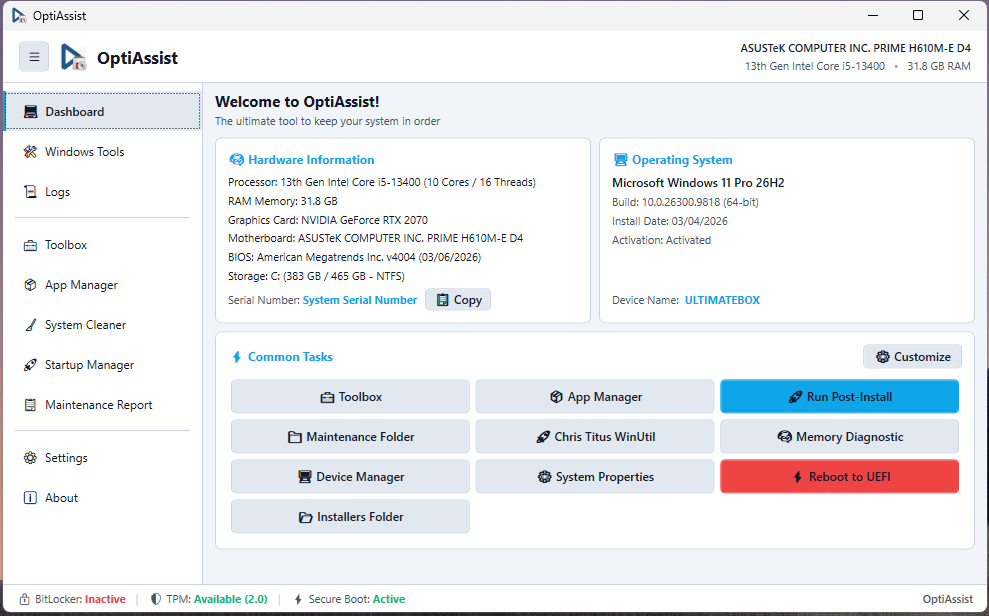
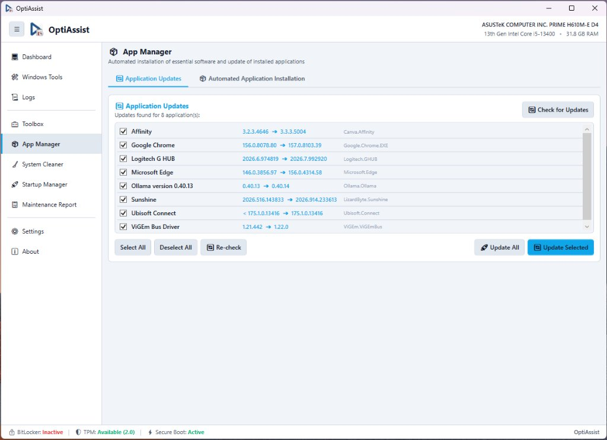
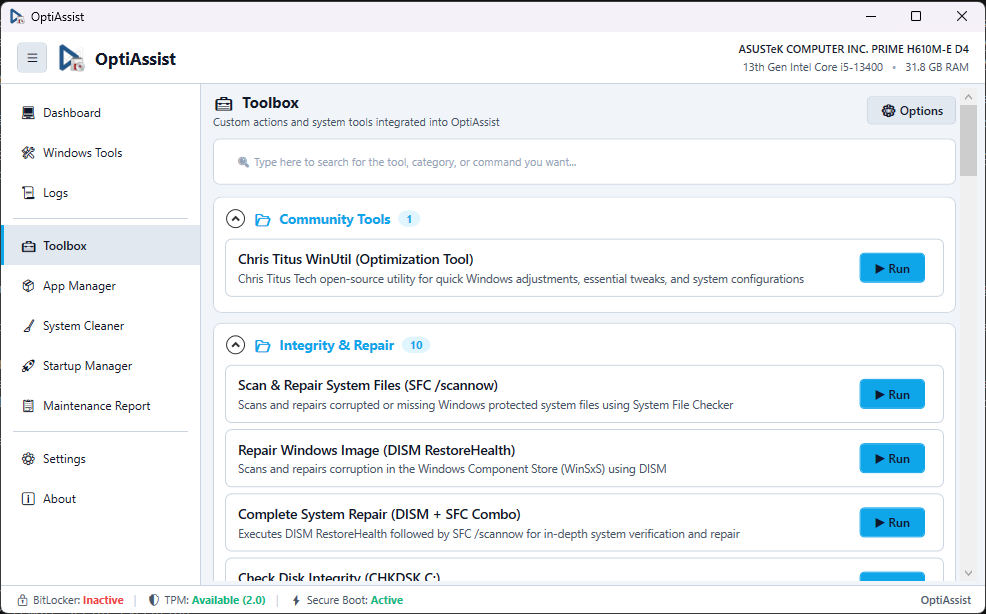
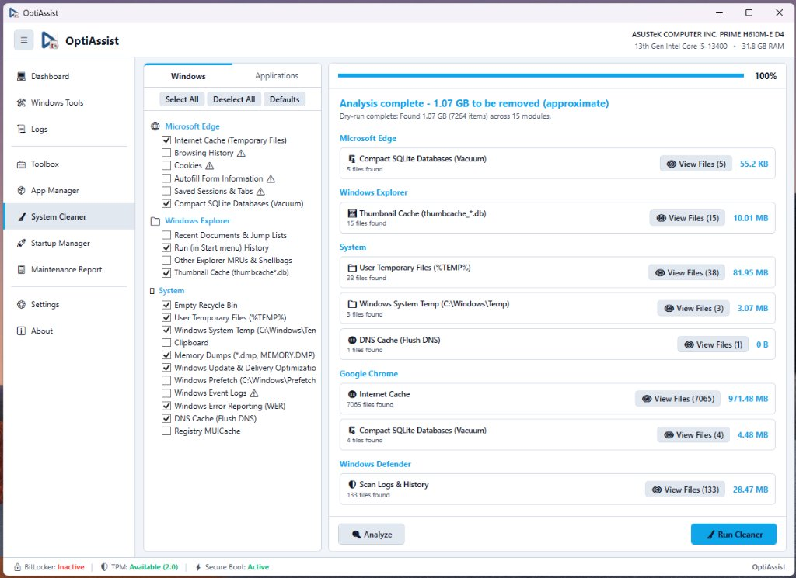
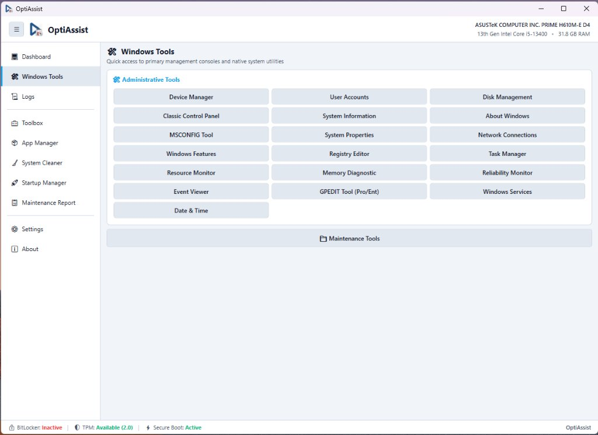

# OptiAssist

**Portable optimization, diagnostic, and post-installation technical assistant for Windows 10 and 11.**

[](https://github.com/jvfigueiro/optiassist)
[-0078D4.svg)](https://microsoft.com/windows)
[](LICENSE)
[](https://dotnet.microsoft.com/)

OptiAssist is a native C#/WPF (.NET Framework 4.8) technician workbench engineered for IT professionals, system administrators, and computer maintenance workshops. It consolidates asynchronous hardware diagnostics, automated post-installation application deployment with offline catalogs and Winget fallback, deep system cleaning routines, a custom command and repair script hub (Toolbox), native Windows administration consoles, and technical service order generation into a single, cohesive portable environment without external dependencies.

---

## Key Features

| Module | Summary Description | Documentation |
| :--- | :--- | :---: |
| **Dashboard** | Asynchronous hardware telemetry (CPU, total RAM, GPU, Motherboard, BIOS, Serial/Service Tag with one-click copy), Windows installation date, activation status, security posture (BitLocker, TPM 2.0, Secure Boot), and fully customizable Common Tasks shortcuts. | [Read Guide](Docs/modulos/dashboard.md) |
| **App Manager** | Batch unattended software deployment via offline local installers (`Installers/`) or official Microsoft Winget repository, with a visual catalog editor (`autoinstall.json`) and batch updates scanner. | [Read Guide](Docs/modulos/app-manager.md) |
| **Toolbox** | Script and command execution engine (PowerShell, CMD, portable binaries) with dynamic categories, standardized search, real-time stdout/stderr streaming, process termination, and Base64 command encoding. | [Read Guide](Docs/modulos/toolbox.md) |
| **System Cleaner** | BleachBit-inspired modular cleaner with non-destructive Dry-Run (Scan) support, path protection (PathSanitizer), locked-file resilience, and deep scans for developer artifacts (`node_modules`, `venv`, `__pycache__`). | [Read Guide](Docs/modulos/system-cleaner.md) |
| **Startup Manager** | Unified autostart inspector: Windows Registry (`Run`/`RunOnce` with `StartupApproved`), Startup folders, and Scheduled Tasks via COM (`Schedule.Service`), with standardized search and risk warnings for native entries. | [Read Guide](Docs/modulos/startup-manager.md) |
| **Windows Tools** | Fast-launch control panel for native administrative consoles (`sysdm.cpl`, `services.msc`, `compmgmt.msc`, `regedit`, `cleanmgr`), technician folders, and direct UEFI firmware reboot. | [Read Guide](Docs/modulos/windows-tools.md) |
| **Maintenance Report** | Technical service order and report generator with client/technician details, an 8-step maintenance checklist, hardware specifications, and structured `.txt` export. | [Read Guide](Docs/modulos/maintenance-report.md) |
| **Settings & Deployment** | Theme personalization (Light/Dark/Accent colors), zero-restart language hot-reloading (i18n), Always on Top window toggle, module management, and built-in installer/uninstaller. | [Read Guide](Docs/modulos/settings-deployment.md) |
| **Logs & Terminal** | Thread-safe real-time diagnostic terminal with an independent floating pop-out window (`LogWindow`), keyword search, clipboard copying, and `.txt` log export. | [Read Guide](Docs/modulos/logs-terminal.md) |

---

## Screenshots

### Dashboard & System Telemetry


### App Manager (Software Updates & Unattended Installation)


### Toolbox (System Repair & Automation Hub)


### System Cleaner (Deep Cleaning & Dry-Run Analysis)


### Windows Tools (Native Management Consoles)


---

## Recent Updates & Enhancements

- **Integrated Common Tasks Customization**: The Common Tasks section on the Dashboard now incorporates an in-app customization engine. Technicians can add, edit, reorder, or remove shortcuts directly via a dedicated **Customize** dialog, including a dedicated shortcut for the `Installers` directory. External shortcuts (e.g. Chris Titus WinUtil) run in the background with visual progress indication.
- **Enhanced Telemetry & Background Refresh**: Clicking the Dashboard navigation button triggers an asynchronous background re-audit of hardware and security settings. The RAM indicator has been refined to display total physical capacity clearly, and the Operating System card now details the Windows installation date and genuine activation status.
- **Startup Manager Modernization**: Standardized search text box styling to match the Toolbox module, removed redundant UI labels, and added an explicit risk warning confirmation dialog when unchecking "Hide native Microsoft / Windows entries" in Scheduled Tasks.
- **Streamlined Settings Layout**: Consolidated deployment controls (Install and Uninstall OptiAssist) directly into the primary actions row alongside Save and Restore Defaults. Added an **Always on Top** window option and modernized the section description.
- **Windows Tools Refinements**: Standardized tool button labels by removing emojis and parenthetical suffixes across all native utilities (Date & Time, Windows Services, User Accounts, System Information, Registry Editor, About Windows, Network Connections), and renamed the technician folder launcher to **Maintenance Tools**.
- **System Cleaner Warning Placement**: Moved the "Disable warnings when selecting items" option into the Developer & Deep Scan section for logical contextual alignment.

---

## System Requirements

- **Operating System**: Windows 10 (version 1809 or higher) or Windows 11 (64-bit recommended).
- **Runtime**: Microsoft .NET Framework 4.8 (pre-installed natively on modern Windows 10 and 11 installations).
- **Privileges**: Requires **Administrator** rights (`requireAdministrator` in application manifest) for WMI hardware inspection, service manipulation, registry autostart management, and temporary file cleaning.
- **Connectivity**: Optional. 100% operational offline; internet access is required only for Winget package downloads or remote script execution.

---

## Installation and Deployment

OptiAssist is designed around a **Zero External Dependencies** model: it does not require third-party installers and runs immediately from a flash drive, external SSD, or local directory.

### Deployment Modes:
1. **Portable Mode (USB / External Storage)**: Copy the OptiAssist folder to any removable drive or partition and run `OptiAssist.exe`. Configuration files and plugins reside entirely alongside the application.
2. **Standard Installation (Local System)**: In **Settings**, click **Install OptiAssist**. The application creates Start Menu and Desktop shortcuts, registers an entry in Windows Control Panel (*Programs and Features*), and copies files to `%ProgramFiles%\OptiAssist`.
3. **USB AutoRun**: From the deployment dialog, generate an `autorun.inf` at the root of a USB flash drive to apply the custom application icon and label in Windows Explorer.

For compilation targets, automated packaging, and silent uninstallation details, refer to the [Build and Distribution Guide](Docs/build-e-distribuicao.md).

---

## Getting Started

1. **Launch**: Right-click `OptiAssist.exe` and select "Run as administrator" (or accept the UAC elevation prompt).
2. **Inspect Telemetry**: Review processor model, total RAM, storage status, and the security indicators (BitLocker, TPM 2.0, Secure Boot) in the bottom bar.
3. **Deploy Software**: Navigate to **App Manager**, choose required applications, and click **Install Selected**. Local installers in `Installers/` run instantly; missing packages fall back to silent Winget downloads.
4. **Run System Maintenance**: In **Toolbox**, execute repair presets such as SFC, DISM, and print spooler resets.
5. **Generate Service Record**: In **Report**, enter customer details, check off performed procedures, and export the technical maintenance record.

---

## Modular Architecture Overview

OptiAssist implements an extensible **Microkernel Pattern with Dynamic In-Memory Module Loading (Add-ons)**:

```
+-------------------------------------------------------------+
|                 Host Kernel (OptiAssist.exe)                |
|  +-------------------+ +----------------+ +--------------+  |
|  | Settings & Config | | i18n Engine    | | Log Pipeline |  |
|  +-------------------+ +----------------+ +--------------+  |
+------------------------------^------------------------------+
                               | Contracts: IOptiAssistAddon / IOptiAssistHost
                               | Anti-Lock in-memory loading (byte[])
+--------------+---------------+--------------+---------------+
|              |                              |               |
v              v                              v               v
AppManager     SystemCleaner                  Toolbox         StartupManager
(Addon DLL)    (Addon DLL)                    (Addon DLL)     (Addon DLL)
```

- **Binary Decoupling**: The host executable coordinates navigation, persistent storage, theming, and logs.
- **Anti-Lock Assembly Loading**: Plugins are read into in-memory byte arrays (`File.ReadAllBytes` + `Assembly.Load`), allowing add-on DLLs on disk to be updated, recompiled, or replaced without locking running processes.
- **Unified Localization**: Multi-language JSON dictionaries (`Config/Languages/`) with instant zero-restart runtime hot-reloading.

For architectural diagrams and component sequence lifecycles, refer to the [Architecture Documentation](Docs/arquitetura.md).

---

## Technology Stack

- **Language**: C# (compatible with C# 7.3+).
- **User Interface**: Windows Presentation Foundation (WPF) / Native XAML.
- **Base Framework**: Microsoft .NET Framework 4.8.
- **System Integrations**: Windows Management Instrumentation (WMI / CIM via `System.Management`), native Win32 APIs, Windows Registry (`Microsoft.Win32`), Windows Package Manager (`winget.exe`), Windows Task Scheduler (`schtasks.exe`), and asynchronous PowerShell/CMD subprocesses.
- **External Dependencies**: **Zero**. JSON parsing, i18n dictionaries, COM shortcut creation, and logging pipelines are implemented entirely using native .NET Framework BCL and Windows platform APIs.

---

## Repository Structure

```text
OptiAssist/
|-- OptiAssist.csproj              # Main WPF (.NET 4.8) project file
|-- OptiAssist.sln                 # Visual Studio Solution
|-- build.bat                      # Automated build script
|-- src/                           # Host core source code
|   |-- app.manifest               # Elevation manifest (requireAdministrator)
|   |-- MainWindow.xaml / .cs      # Shell window and navigation coordinator
|   |-- AddonHelper.cs             # Add-on discovery engine and contracts
|   |-- LocalizationHelper.cs      # Multi-language translation engine (i18n)
|   |-- SettingsHelper.cs          # Zero-dependency JSON settings engine
|   |-- ShortcutsHelper.cs         # AppDeploymentHelper (installer, shortcuts, autorun)
|   |-- SystemInfoHelper.cs        # Asynchronous WMI telemetry (HardwareSummary)
|   |-- TweakHelper.cs             # Registry and process optimization utilities
|   `-- LogWindow.cs               # Detached floating log window
|-- src/Addons/                    # Decoupled plugin projects
|   |-- AppManager/                # Installer and Winget management
|   |-- MaintenanceReport/         # Technical report and checklist generator
|   |-- StartupManager/            # Startup items and task scheduler inspector
|   |-- SystemCleaner/             # Deep cleaner engine and dry-run scanner
|   `-- Toolbox/                   # Script runner and automation hub
|-- Config/                        # Configurations, catalogs, and translations
|   |-- settings.json              # Global user preferences
|   |-- autoinstall.json           # Software installation catalog
|   |-- toolbox.json               # Configured repair and optimization scripts
|   |-- custom_shortcuts.json      # Customizable Dashboard common tasks
|   |-- Languages/                 # Multi-language dictionaries (en-US, pt-BR)
|   `-- Addons/                    # Compiled plugin DLL binaries
|-- Maintenance/                   # Auxiliary portable diagnostics
`-- Docs/                          # Complete technical documentation
```

---

## How to Contribute and Create Modules

Extending OptiAssist does not require modifying the host executable. Custom modules can be developed as independent Class Libraries (.NET Framework 4.8) implementing the `IOptiAssistAddon` interface:

1. Create a Class Library project referencing `OptiAssist.exe` with `<Private>False</Private>`.
2. Implement `IOptiAssistAddon` and build your user interface inside `CreateView()`.
3. Add custom translation keys to the language JSON files.
4. Compile the output DLL into `Config/Addons/<YourModule>/<YourModule>.dll`.

Read the comprehensive step-by-step developer tutorial in [How to Create a Module in OptiAssist](Docs/como-criar-um-modulo.md).

---

## Disclaimer

> [!WARNING]
> OptiAssist executes administrative operations that modify system configurations, including Windows Registry keys, background services, scheduled tasks, and temporary system files.
> 
> This tool is intended for support technicians, system administrators, and advanced users. Always review selected scripts and automation tasks before executing operations. The developers and contributors assume no liability for data loss or system instability resulting from improper use.

---

## License

This project is free software distributed under the terms of the **GNU General Public License v3.0 (GNU GPLv3)**. For more details, refer to the [LICENSE](LICENSE) file or access the built-in license dialog in the application (*Settings* -> *License*).

---

## Technical Documentation Index (`Docs/`)

For in-depth technical specifications, refer to the dedicated documentation files:

- [Architecture Map and Code Analysis](Docs/_analise/00-mapa.md)
- [System Architecture and Module Lifecycle](Docs/arquitetura.md)
- [Developer Guide: How to Create a Module](Docs/como-criar-um-modulo.md)
- [Build, Packaging, and Distribution](Docs/build-e-distribuicao.md)
- [Configuration, JSON Schemas, i18n, and Logging](Docs/configuracao-e-logs.md)
- [FAQ and Troubleshooting Guide](Docs/faq-e-troubleshooting.md)
- [Module Index and Detailed Documentation](Docs/modulos/README.md)
  - [Dashboard](Docs/modulos/dashboard.md)
  - [App Manager](Docs/modulos/app-manager.md)
  - [Toolbox](Docs/modulos/toolbox.md)
  - [System Cleaner](Docs/modulos/system-cleaner.md)
  - [Startup Manager](Docs/modulos/startup-manager.md)
  - [Windows Tools](Docs/modulos/windows-tools.md)
  - [Maintenance Report](Docs/modulos/maintenance-report.md)
  - [Settings & Deployment](Docs/modulos/settings-deployment.md)
  - [Logs & Terminal](Docs/modulos/logs-terminal.md)
